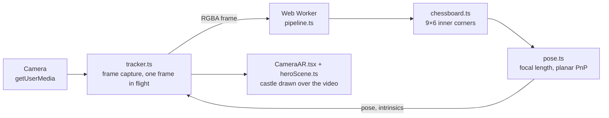

# Portfolio

**English** | [简体中文](README.zh-CN.md)

My bilingual portfolio site, live at [portfolio-troy-0de3.vercel.app](https://portfolio-troy-0de3.vercel.app). It is a static Next.js export: every page is generated at build time, the projects come straight from my public GitHub repositories, and the home page runs a live three.js scene with WebXR and a camera AR demo that tracks a printed chessboard in the browser.

## Features

- **English and Chinese.** Every page exists under `/en` and `/zh`. The root path picks a language in the browser (the last choice from the language switch, else the browser language), and the switch keeps you on the same page.
- **Projects synced from GitHub.** Before each build, `scripts/fetch-github.mjs` fetches my public, non-fork repositories with their languages, topics, READMEs in each language and declared dependencies. Projects are sorted into categories and their tech stacks are recognised automatically. A GitHub Action redeploys the site every day, so a new repository shows up within a day.
- **Project pages.** Each project gets a page with its README (Mermaid diagrams included), language breakdown, tech stack, topics, stats and an optional demo video (YouTube on the English page, Bilibili on the Chinese page). Cards use a cover image from the README, or a line drawing for the category.
- **Live 3D hero.** A three.js scene modelled on my SceneGraph AR project: a castle on a calibration board with OpenCV-style corner markers, a camera that follows the pointer, and an FPS and pose readout. On WebXR devices (Quest, Vision Pro) it can be opened in AR or VR.
- **Camera AR.** "Try camera AR" opens a full-screen view of the device camera and puts the castle on a real 10×7 chessboard. Corner detection, planar pose and focal-length estimation are written from scratch in TypeScript and run in a Web Worker. No OpenCV.js is involved.
- **About, contact and privacy pages**, a bilingual 404 page, and share images generated at build time (`/og.png`, `/apple-touch-icon.png`).
- **Accessibility.** Skip link, visible focus, keyboard-only navigation, and motion that follows the system's "reduce motion" setting.

## Tech stack

| Area | Technology |
| :--- | :--- |
| Framework | Next.js 16 (App Router, `output: "export"`, Turbopack), React 19, TypeScript 5 |
| Styling | Tailwind CSS 4, `@tailwindcss/typography` for READMEs |
| Motion | Motion (`motion/react`) |
| 3D and XR | three.js, WebXR |
| Camera AR | `getUserMedia`, Web Workers, a chessboard detector and planar PnP written in TypeScript |
| Other | Phosphor Icons, Mermaid, Geist fonts via `next/font`, `next/og` for images |
| Tests | Vitest 4 in Node |
| Hosting | Vercel, with a daily GitHub Actions redeploy |

## Getting started

Requires Node.js 20 or later.

```bash
npm ci
npm run dev
```

Open <http://localhost:3000>. `npm run dev` and `npm run build` fetch the GitHub data first; if the fetch fails locally, the last snapshot in `src/data/github.generated.json` is reused.

| Command | What it does |
| :--- | :--- |
| `npm run dev` | Development server |
| `npm run build` | Static site in `out/` |
| `npm test` | Unit tests (`vitest run`) |
| `npm run lint` | ESLint |
| `npm run fetch-github` | Refresh the GitHub snapshot only |

Environment variables, all optional:

| Variable | Purpose |
| :--- | :--- |
| `GITHUB_TOKEN` | Read-only token that raises the GitHub API limit from 60 to 5,000 requests an hour. Recommended on Vercel |
| `GITHUB_USER` | Whose repositories to show; default `ZJUCao` |

The camera needs a secure context, so camera AR works on `localhost` and over HTTPS but not on a LAN `http://` address.

## Project structure

```text
src/
  app/            routes: /, /[lang], about, contact, privacy, projects, projects/[slug],
                  the 404 page and the generated images
  components/     UI; heroScene.ts (three.js), HeroViewport.tsx and CameraAR.tsx (camera AR overlay)
  data/
    profile.ts    all personal content and UI copy, in Chinese and English
    projects.ts   GitHub repositories → projects: categories, overrides, featured projects
    skills.ts     skill groups and the table that recognises tech stacks
  ar/             camera AR: board geometry, detector, pose, worker pipeline, main-thread tracker
  i18n.ts         locales
scripts/
  fetch-github.mjs  build-time GitHub fetch
tests/ar/         unit tests and helpers for camera AR
docs/             camera AR design and test plan, in English and Chinese
```

## Editing content

- **Text about me** (bio, experience, skills, FAQ, UI copy): `src/data/profile.ts`.
- **Projects** need no code changes: a public repository appears on the next build. To give one a title or summary in each language, a category, a cover, a demo video, or to feature or hide it, add an entry to `overrides` in `src/data/projects.ts`. A repository that lands in the wrong category can also be fixed with a GitHub topic such as `augmented-reality` or `game-engine`.
- **Skills** on the About page combine the hand-written list in `profile.ts` with the technologies detected in my projects. The detection table is in `src/data/skills.ts`.

## Camera AR



The detector, pose solver and pipeline do not depend on the DOM, so they run in the worker and in Node tests. The overlay and its code load only when it is opened. The open state is kept in the URL (`?ar=camera`), so the Back button closes it and a link can open it directly.

The feature is built in four phases. Phases 1–3 are done: the detector, the pose and worker pipeline, and the camera overlay. Phase 4 adds an on-screen board, a QR code that hands off from desktop to phone, and a printable PDF board. Until then, print any 10×7-square chessboard with 25 mm squares. The design, with its interface contracts, and the test plan are in `docs/` ([design](docs/design_camera_ar.md), [test plan](docs/test_plan_camera_ar.md)).

## Deployment

The site is deployed on Vercel. `.github/workflows/refresh-projects.yml` calls a Vercel deploy hook every day at 09:00 UTC so the project list stays current. To enable it, add the hook URL as the `VERCEL_DEPLOY_HOOK` repository secret; without it the job does nothing.
