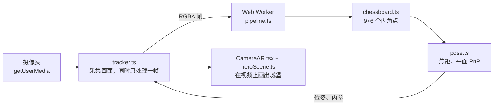

# 个人作品集

[English](README.md) | **简体中文**

我的中英双语个人作品集网站，地址是 [yu-cao.vercel.app](https://yu-cao.vercel.app)。网站用 Next.js 静态导出：所有页面在构建时生成，项目直接来自我在 GitHub 上的公开仓库；首页有一个实时运行的 three.js 场景，支持 WebXR，还能在浏览器里用摄像头追踪一张打印出来的棋盘格，做 AR 演示。

## 功能

- **中英双语。** 每个页面都有 `/en` 和 `/zh` 两个版本。访问根路径时在浏览器里选语言：优先用上次在语言切换按钮上的选择，否则看浏览器语言；切换语言时停留在同一页面。
- **项目从 GitHub 同步。** 每次构建前，`scripts/fetch-github.mjs` 拉取我自己的公开仓库（不含 fork），连同编程语言、topics、各语言版本的 README 和声明的依赖。项目会自动分类，并自动识别技术栈。GitHub Actions 每天重新部署一次，新仓库最晚一天后出现在网站上。
- **项目详情页。** 每个项目有一页，显示 README（包括 Mermaid 图）、语言占比、技术栈、topics、统计数据，还可以嵌入演示视频（英文页用 YouTube，中文页用 B 站）。项目卡片的封面取自 README 里的图片，没有图片时按分类画一幅线稿。
- **首页 3D 场景。** 仿照我的 SceneGraph AR 项目：标定板上立着一座城堡，叠加 OpenCV 风格的角点标记，镜头跟着鼠标偏转，还有帧率和位姿读数。在支持 WebXR 的设备上（Quest、Vision Pro）可以进入 AR 或 VR 查看。
- **摄像头 AR。** 点“用摄像头看 AR”会全屏打开设备摄像头，把城堡放到一张真实的 10×7 棋盘格上。角点检测、平面位姿和焦距估计都是用 TypeScript 从头写的，在 Web Worker 里运行，没有用 OpenCV.js。在电脑上会先在屏幕上显示标定板和一个二维码：用手机扫码，再把手机对准屏幕即可。标定板也可以下载 PDF 打印出来。
- **关于、联系和隐私说明页**，中英文同屏的 404 页，以及构建时生成的分享图（`/og.png`、`/apple-touch-icon.png`）。
- **无障碍。** 有“跳到正文”链接、看得见的焦点框，只用键盘也能操作，动效跟随系统的“减少动态效果”设置。

## 技术栈

| 方面 | 技术 |
| :--- | :--- |
| 框架 | Next.js 16（App Router、`output: "export"`、Turbopack）、React 19、TypeScript 5 |
| 样式 | Tailwind CSS 4，README 排版用 `@tailwindcss/typography` |
| 动效 | Motion（`motion/react`） |
| 3D 与 XR | three.js、WebXR |
| 摄像头 AR | `getUserMedia`、Web Worker，用 TypeScript 写的棋盘格检测器和平面 PnP |
| 其他 | Phosphor Icons、Mermaid、通过 `next/font` 加载的 Geist 字体、用 `next/og` 生成图片 |
| 测试 | Vitest 4，在 Node 中运行 |
| 部署 | Vercel，GitHub Actions 每天重新部署 |

## 本地运行

需要 Node.js 20 或更高版本。

```bash
npm ci
npm run dev
```

然后打开 <http://localhost:3000>。`npm run dev` 和 `npm run build` 会先拉取 GitHub 数据；本地拉取失败时沿用上次保存在 `src/data/github.generated.json` 里的数据。

| 命令 | 作用 |
| :--- | :--- |
| `npm run dev` | 开发服务器 |
| `npm run build` | 生成静态网站到 `out/` |
| `npm test` | 单元测试（`vitest run`） |
| `npm run lint` | ESLint |
| `npm run fetch-github` | 只刷新 GitHub 数据 |

环境变量都是可选的：

| 变量 | 用途 |
| :--- | :--- |
| `GITHUB_TOKEN` | 只读 token，把 GitHub API 的额度从每小时 60 次提高到 5000 次。建议在 Vercel 上配置 |
| `GITHUB_USER` | 展示谁的仓库，默认 `ZJUCao` |

摄像头只能在安全上下文中使用，所以摄像头 AR 在 `localhost` 和 HTTPS 下可用，在局域网的 `http://` 地址上不可用。

## 目录结构

```text
src/
  app/            路由：/、/[lang]、about、contact、privacy、projects、projects/[slug]，
                  以及 404 页和生成的图片
  components/     界面组件；heroScene.ts（three.js）、HeroViewport.tsx 和 CameraAR.tsx（摄像头 AR 叠层）
  data/
    profile.ts    所有个人内容和界面文案，中英两种语言
    projects.ts   GitHub 仓库 → 项目：分类、覆盖设置、精选项目
    skills.ts     技能分组，以及识别技术栈用的对照表
  ar/             摄像头 AR：标定板几何、检测器、位姿、worker 流水线、主线程追踪器
  i18n.ts         语言设置
scripts/
  fetch-github.mjs  构建时拉取 GitHub 数据
tests/ar/         摄像头 AR 的单元测试和辅助代码
docs/             摄像头 AR 的设计文档和测试计划，中英两版
```

## 修改内容

- **关于我的文字**（简介、经历、技能、FAQ、界面文案）：`src/data/profile.ts`。
- **项目**不用改代码：公开仓库会在下一次构建时出现。要给某个项目写中英文标题或简介、指定分类、封面、演示视频，或者设为精选、隐藏，就在 `src/data/projects.ts` 的 `overrides` 里加一项。分类不对时，也可以在 GitHub 上给仓库加一个 topic，如 `augmented-reality`、`game-engine`。
- **关于页的技能**由 `profile.ts` 里手写的技能和项目里自动识别出的技术合并而成，识别用的对照表在 `src/data/skills.ts`。

## 摄像头 AR



检测器、位姿求解和流水线都不依赖 DOM，所以既能在 worker 里运行，也能在 Node 里测试。叠层和它的代码只在打开时才加载。叠层是否打开记在网址里（`?ar=camera`），按返回键能关闭，带这个参数的链接也能直接打开它。

叠层有两个画面，记在网址里：`?ar=camera` 和 `?ar=board`。标定板画面显示 10×7 的标定板，四周留白边，并保持屏幕常亮；在电脑上旁边还有一个二维码，用手机扫了直接打开摄像头画面。`/chessboard.pdf` 在构建时生成：一页 A4 横向，每格 25 毫米，下面有一条 50 毫米的比例尺，用来核对打印比例。

这个功能分四期开发完成：检测器、位姿和 worker 流水线、摄像头叠层，以及标定板画面、二维码和 PDF。设计文档（含接口契约）和测试计划在 `docs/` 里（[设计文档](docs/design_camera_ar.zh.md)、[测试计划](docs/test_plan_camera_ar.zh.md)）。

## 部署

网站部署在 Vercel 上。`.github/workflows/refresh-projects.yml` 每天 UTC 9:00 调用一次 Vercel 的 Deploy Hook，让项目列表保持最新。要启用它，把 Deploy Hook 的地址添加为仓库的 `VERCEL_DEPLOY_HOOK` secret；没有配置时这个任务什么也不做。
