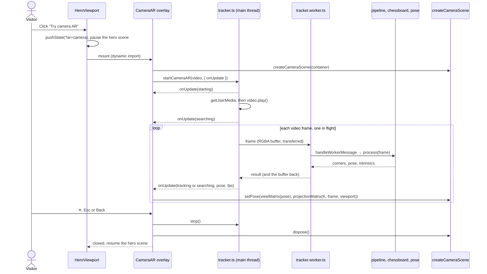

# Design: Camera AR on a calibration board

Status: **Confirmed 2026-11-02**, P1 and P2 done, P3 next · Tier: Full · Phases: P1–P4, with P2 in two batches (§10)

## 1. Goal

Let any visitor see the hero castle standing on a real chessboard through their device camera, in the browser: iPhone Safari, Android Chrome and desktop webcams. The board is the 10×7-square (9×6 inner corners) pattern that the hero scene and SceneGraph AR already use. Detection and pose estimation are written in TypeScript (no OpenCV.js), run in a Web Worker, and drive the existing three.js castle.

Out of scope: lens distortion correction, several boards at once, board sizes other than 9×6, recording or sharing, and the existing WebXR buttons (they stay as they are).

## 2. Facts this design rests on

| Fact | Consequence |
| :--- | :--- |
| No published opencv.js build (4.x, 5.x, `@techstark/opencv-js`) exports `findChessboardCorners`, `findChessboardCornersSB` or `cornerSubPix` | Detection and sub-pixel refinement are implemented in TypeScript (decision Q1) |
| iOS Safari has no WebXR; `getUserMedia` works there over HTTPS | Camera AR uses `getUserMedia` plus our own tracking, not WebXR |
| Camera access needs a secure context (HTTPS or localhost) | Vercel production works; a LAN `http://` dev URL cannot open a phone's camera |
| The site is a static export (`output: "export"`) | Everything runs client-side; the printable PDF is a `force-static` GET route handler, like `og.png` |
| The hero sits inside `Reveal`, which animates a `y` transform | A `position: fixed` overlay inside it would be positioned against that ancestor, so the overlay is portalled to `document.body` |
| Next.js 16 integrates `window.history.pushState` with its router | The overlay's open state lives in the URL (`?ar=camera`, `?ar=board`), so Back closes it and a QR link can open it |

## 3. Decisions

Confirmed on 2026-11-02:

| # | Decision |
| :--- | :--- |
| Q1 | Pure TypeScript detector and planar PnP |
| Q2 | A hero button opens a full-screen overlay |
| Q3 | On-screen board, printable PDF, and a QR code that hands off from desktop to phone |

Also confirmed on 2026-11-02, option A of each:

| # | Detail | A (chosen) | B (rejected) |
| :--- | :--- | :--- | :--- |
| D1 | Focal length | Estimated from the board: median of recent estimates, field of view clamped to 40–100°, starting at 60° | Fixed 60° horizontal field of view |
| D2 | Front camera image | Not mirrored | Mirrored like a selfie (video and canvas flipped with CSS) |
| D3 | Board lost | Keep the last pose for 0.5 s, then hide the castle | Hide the castle immediately |
| D4 | Which camera | Rear camera if there is one, else the default; no switch button | Add a front/rear switch button |
| D5 | First view on desktop | Desktop (no coarse pointer) opens the board view with the QR code; phones and tablets open the camera | Always open the camera first |
| D6 | Landing from the QR code | Camera starts right away (the browser asks for permission) | Show a Start button first |
| D7 | Pose readout | Metres, assuming 25 mm squares, with a note saying so | In board squares |
| D8 | Printable board | A4 landscape PDF | SVG |
| D9 | WebXR buttons | Camera AR and WebXR buttons both shown | Hide camera AR where WebXR AR is supported |
| D10 | Browsers without camera access | Hide the camera AR button | Show it and explain on click |
| D11 | Overlay annotations | Show OpenCV-style corner lines and axes on the real board | Castle only |
| D12 | Real-photo test fixtures | You provide 5–10 photos of the printed board | Synthetic images only |
| D13 | Reduced motion | Camera AR stays available; the scan-ring animation is off | Same as normal |
| D14 | Button placement | Bottom right of the hero viewport, before the WebXR buttons; the "move the pointer" hint is no longer shown there | Top right next to the FPS readout; the hint stays |

The test plan raised open questions OQ-01–OQ-60, resolved the same day. §14 lists the resolutions; they are part of this contract and refine the wording of §5–§11.

## 4. Modules

| Module | Owns | Must not know about | Phase |
| :--- | :--- | :--- | :--- |
| `src/ar/board.ts` | Board geometry constants and inner-corner coordinates | images, three.js, DOM | P1 |
| `src/ar/chessboard.ts` | RGBA to grey, inner-corner detection, ordering, sub-pixel refinement, tracking hint | intrinsics, pose, three.js, DOM | P1 |
| `src/ar/pose.ts` | Intrinsics model, planar PnP, focal estimation, three.js view and projection matrices as plain arrays | images, DOM, three.js at runtime | P2 |
| `src/ar/pipeline.ts` | Per-frame processing (grey → detect → smooth → focal → pose), corner filter, focal tracker, worker message handling | DOM, the Worker global, three.js | P2 |
| `src/ar/tracker.worker.ts` | Worker entry: forwards messages to `handleWorkerMessage` | anything beyond the pipeline | P2 |
| `src/ar/tracker.ts` | Main thread: camera stream, frame capture, worker loop with one frame in flight, status machine, fps | three.js, React, detection internals | P3 |
| `src/components/heroScene.ts` | (existing) castle world; adds `createCameraScene` and `setPaused` | camera, detection | P3 |
| `src/components/CameraAR.tsx` | Overlay UI: camera view, HUD, errors, close; later board view and QR code | detection internals | P3, P4 |
| `src/components/HeroViewport.tsx` | (existing) entry button, URL-synced open state, lazy-loading the overlay, pausing the hero scene | detection internals | P3, P4 |
| `src/app/chessboard.pdf/route.ts` | Build-time A4 PDF of the board | everything else | P4 |
| `src/data/profile.ts` | (existing) zh and en copy for the button and the overlay | — | P3, P4 |

Dependencies point one way: `chessboard → board`; `pipeline → chessboard, pose, board`; `tracker.worker → pipeline`; `tracker → pipeline (types only)`; `CameraAR → tracker, pose, heroScene`; `HeroViewport → CameraAR (dynamic import), heroScene`; `heroScene → board`. Everything in `src/ar/` except `tracker.ts` is DOM-free, so it runs in Node for tests and inside the worker. `heroScene.ts` is never imported by the worker, which keeps three.js out of the worker bundle.

## 5. Interface contracts

### 5.1 `src/ar/board.ts` (P1)

```ts
export const BOARD: {
  readonly squaresX: 10; readonly squaresY: 7;  // squares along the long and short side
  readonly cornersX: 9; readonly cornersY: 6;   // inner corners
  readonly squareSize: 0.24;                    // scene units per square (heroScene's SQUARE)
  readonly squareMeters: 0.025;                 // printed square size
};

/** Board-plane coordinates (X, Y) of every inner corner in detector order. */
export function boardCorners(): Float64Array;
```

- Layout: square (r, c) with r ∈ [0, 7) and c ∈ [0, 10) is dark iff r + c is even, so square (0, 0) is dark. Inner corner (i, j) is the common vertex of squares (j, i), (j, i+1), (j+1, i) and (j+1, i+1).
- `boardCorners()` returns a new array of length 2 · 9 · 6. Corner k = j · 9 + i is at [2k, 2k+1] with X = (i + 1 − 10/2) · 0.24 and Y = (j + 1 − 7/2) · 0.24. So corner 0 is (−0.96, −0.6), corner 53 is (0.96, 0.6), and the centroid is (0, 0).
- heroScene's `COLS`, `ROWS` and `SQUARE` are taken from `BOARD`, so the virtual and the detected board cannot drift apart.

### 5.2 `src/ar/chessboard.ts` (P1)

```ts
export interface GrayImage {
  readonly width: number;
  readonly height: number;
  readonly data: Uint8Array | Uint8ClampedArray; // row-major, one byte per pixel
}

export function rgbaToGray(
  rgba: Uint8Array | Uint8ClampedArray, width: number, height: number, out?: Uint8Array,
): GrayImage;

export interface DetectOptions {
  /** Corners found in the previous frame, same layout as the result. A hint only. */
  readonly previous?: Float32Array | null;
}

export function findChessboardCorners(
  image: GrayImage, cornersX: number, cornersY: number, options?: DetectOptions,
): Float32Array | null;
```

`rgbaToGray`
- Grey = 0.299 R + 0.587 G + 0.114 B (BT.601), alpha ignored; each output value is within 1 of the rounded exact value.
- When `out` is given it is filled and returned as `data`.
- Throws `RangeError` when width or height is not a positive integer, when `rgba.length ≠ 4 · width · height`, or when `out` has the wrong length.

`findChessboardCorners`
- Preconditions, otherwise `RangeError`: `image.data.length = width · height` with positive integer sizes; `cornersX` and `cornersY` are integers ≥ 2, differ from each other, and have an odd sum (so the board's colouring tells its two 180°-rotated orientations apart; 9 + 6 qualifies); `previous`, when given, has length 2 · cornersX · cornersY.
- Result: a new `Float32Array` of length 2 · cornersX · cornersY. Corner k = j · cornersX + i is at [2k, 2k+1]. Coordinates are pixels with pixel (u, v)'s centre at (u, v), so the image spans [−0.5, width − 0.5] × [−0.5, height − 0.5].
- Ordering, which together makes the result unique:
  - **O1** i runs along the side with cornersX corners, j along the side with cornersY corners.
  - **O2** not mirrored: cross(p(1,0) − p(0,0), p(0,1) − p(0,0)) > 0, where cross(a, b) = a.x · b.y − a.y · b.x and image y points down.
  - **O3** the square diagonally outward from corner 0 is dark (square (0, 0) in §5.1).
- Scope: the accuracy, rejection and tracking guarantees below apply to (cornersX, cornersY) = (9, 6) and (6, 9). Other sizes that meet the preconditions are accepted, but only rejection (d) is promised for them (OQ-09). §14 OQ-07–OQ-17 refine the clauses below.
- Accuracy under **nominal conditions**: the whole board, outer squares included, plus a light margin of at least 0.25 square is inside the image; every projected square edge is ≥ 12 px; tilt (angle between the board normal and the ray to the board centre) ≤ 60°; any in-plane rotation; Gaussian blur σ ≤ 1.0 px; additive Gaussian noise σ ≤ 4 grey levels; dark/light contrast ≥ 80 grey levels; a linear illumination gradient of up to ±25 % across the board. Under these conditions the result is non-null, satisfies O1–O3, and has an RMS corner error ≤ 0.25 px and a maximum error ≤ 0.6 px against ground truth.
- Rejection, returns `null`: (a) no board in the image (uniform, noise, gradients, random rectangles, text-like texture); (b) any inner corner outside the image; (c) any inner corner occluded; (d) the visible lattice has a different size from the one requested, larger or smaller. With inner corners within 3 px of the image border the result may be either `null` or a result meeting the accuracy bound. It never returns a wrongly sized or wrongly ordered lattice: `null` is always preferable to a wrong answer.
- Tracking hint: `previous` never changes what counts as a correct answer. With any `previous` (correct, stale or garbage) the result meets the same guarantees as without it. When `previous` holds the corners of the previous frame and the board moved ≤ 0.25 square since, the result is non-null under nominal conditions.
- Deterministic: the same input gives the same output. The function does not modify its inputs.
- Performance (checked in §9, not a hard contract): median ≤ 30 ms for a 640×360 frame on a desktop CPU in Node, ≤ 5 ms with a valid `previous`; on phones at least 20 results per second at 640×360.

### 5.3 `src/ar/pose.ts` (P2)

```ts
export interface Size { readonly width: number; readonly height: number }
/** Pinhole intrinsics in pixels, pixel-centre convention (§6). */
export interface Intrinsics { readonly fx: number; readonly fy: number; readonly cx: number; readonly cy: number }
/** Board frame → OpenCV camera frame. R is 3×3 row-major; t is the board origin in camera coordinates, board units. */
export interface Pose { readonly R: Float64Array; readonly t: Float64Array; readonly rms: number }

export function intrinsicsFromFov(width: number, height: number, hfovDeg: number): Intrinsics;
export function solvePlanarPnP(objectXY: ArrayLike<number>, imageXY: ArrayLike<number>, K: Intrinsics): Pose | null;
export function estimateFocal(objectXY: ArrayLike<number>, imageXY: ArrayLike<number>, width: number, height: number): number | null;
export function viewMatrix(pose: Pose): Float64Array;
export function projectionMatrix(K: Intrinsics, image: Size, viewport: Size, near: number, far: number): Float64Array;
export function cameraPosition(pose: Pose): Float64Array;
```

`intrinsicsFromFov`: fx = fy = (width / 2) / tan(hfov / 2), cx = (width − 1) / 2, cy = (height − 1) / 2. `RangeError` when width or height ≤ 0 or hfovDeg ∉ (0, 180).

`solvePlanarPnP`
- Preconditions, otherwise `RangeError`: both arrays have the same even length 2N with N ≥ 4, all values finite, all intrinsics finite with fx, fy > 0. Object points lie on the board plane Z = 0.
- Returns `null` when the problem is degenerate: no four object points are in general position (no three on a line), no four image points are (OQ-61), or there is no finite solution with the board entirely in front of the camera (OQ-67). It also returns `null` when the board points are in front of the camera but the board origin is not, so that t_z > 0 holds; only object points far from their origin can cause this, and `boardCorners()` are centred on it (OQ-69).
- Postconditions: R is orthonormal (max |RᵀR − I| ≤ 1e−9) with det R = +1; t_z > 0; `rms` is the square root of the mean squared pixel distance between `imageXY` and K(R · [X Y 0]ᵀ + t).
- Accuracy: on exact projections the rotation error is ≤ 1e−6 rad and |t − t_true| ≤ 1e−6 · |t_true| (scope: OQ-19). With σ = 0.3 px noise on the 54 corners, the board spanning at least a third of the image width and the true K, in each of 20 seeded trials: rotation error ≤ 0.5° for tilt 35–60° and ≤ 3° for tilt 0–35°, because a near-frontal planar target constrains rotation poorly (OQ-18); translation error ≤ 1 % of |t_true| for tilt 0–60°.
- The final pose minimises pixel reprojection error, so its `rms` is no larger than that of the homography-only estimate.

`estimateFocal`
- Estimates the focal length in pixels from the board-to-image homography, assuming square pixels, zero skew and the principal point at ((width − 1) / 2, (height − 1) / 2). Same `RangeError` rules as `solvePlanarPnP`, plus positive width and height.
- Tilt here is the angle between the board normal and the camera's optical axis (OQ-23). The guarantees below assume a true horizontal field of view of 40–100°, the clamp range of D1 (OQ-62). Returns `null` when the view is close to fronto-parallel: for tilt < 10° always with exact data, whatever the board's size, and with σ ≤ 0.3 px noise when the board spans at least 40 % of the image width (OQ-62); possibly for tilt 10–25°. With tilt 25–60°, exact or σ ≤ 0.3 px data and the board spanning at least 40 % of the image width, it returns a value (OQ-24). Outside these conditions it may return `null` or a value. It also returns `null` for degenerate point sets (OQ-25) and when the estimate is not finite and positive.
- Accuracy: exact data with tilt ≥ 30°: within 1 % of the true focal length. σ = 0.3 px noise, tilt 45°, board spanning at least 40 % of the image width: within 10 % in each of 20 seeded trials.
- Scale invariance: multiplying every object point by the same factor s > 0 changes the estimate by at most 1e−9 relative, for exact and noisy data alike (OQ-63).

`viewMatrix`: a new 16-element column-major matrix (the `THREE.Matrix4` element order) V such that for every scene point p = (x, y, z), V · [p, 1] = [F · (R · B · p + t), 1], where B = [[1, 0, 0], [0, 0, 1], [0, −1, 0]] maps scene to board coordinates and F = diag(1, −1, −1) maps the OpenCV camera to the three.js camera (§6).

`projectionMatrix`: a new 16-element column-major matrix P for three.js such that a point with OpenCV camera coordinates (X, Y, Z), Z > 0, lands after perspective division where it appears in a viewport W × H that shows the w × h analysis image scaled like CSS `object-fit: cover` (uniform scale s = max(W / w, H / h), centred):
- x_ndc = (2 s fx / W) · (X / Z) + (s / W) · (2 cx + 1 − w)
- y_ndc = −(2 s fy / H) · (Y / Z) − (s / H) · (2 cy + 1 − h)
- depth: near maps to −1 and far to +1 (OpenGL convention).

`RangeError` when a size is not positive and finite, when K has a non-finite value or fx or fy ≤ 0 (OQ-70), or unless near and far are finite with 0 < near < far (OQ-22, OQ-64).

`cameraPosition`: the camera centre in scene coordinates, B⁻¹ · (−Rᵀ t), as a new 3-element array. The HUD converts it to metres (× 0.025 / 0.24) and yaw (atan2(x, z) in degrees), the same way the hero scene does today.

### 5.4 `src/ar/pipeline.ts` and `src/ar/tracker.worker.ts` (P2)

```ts
export interface FrameInput { readonly width: number; readonly height: number; readonly rgba: Uint8ClampedArray; readonly time: number } // time in ms
export interface FrameOutput {
  readonly found: boolean;
  readonly corners: Float32Array | null;   // smoothed corners, detector layout
  readonly pose: Pose | null;
  readonly intrinsics: Intrinsics;         // the intrinsics the pose was solved with
  readonly ms: number;                     // processing time
}
export interface PipelineOptions {
  readonly hfovDeg?: number;               // default 60
  readonly autoFocal?: boolean;            // default true (D1)
  readonly smoothing?: boolean;            // default true
}
export function createPipeline(options?: PipelineOptions): { process(frame: FrameInput): FrameOutput; reset(): void };

export interface CornerFilterOptions { readonly minCutoff?: number; readonly beta?: number; readonly dCutoff?: number } // One Euro, Hz
export function createCornerFilter(options?: CornerFilterOptions): {
  apply(corners: Float32Array, time: number): Float32Array;
  reset(): void;
};

export interface FocalTrackerOptions {
  readonly hfovDeg: number;
  readonly minFovDeg?: number;             // default 40
  readonly maxFovDeg?: number;             // default 100
  readonly window?: number;                // default 15
  readonly minSamples?: number;            // default 5
}
export function createFocalTracker(options: FocalTrackerOptions): {
  add(estimate: number | null): void;
  focal(width: number): number;
  reset(): void;
};

export type WorkerRequest =
  | { readonly type: "frame"; readonly id: number; readonly width: number; readonly height: number; readonly buffer: ArrayBuffer; readonly time: number }
  | { readonly type: "reset" };
export type WorkerResponse =
  | { readonly type: "result"; readonly id: number; readonly found: boolean; readonly corners: Float32Array | null;
      readonly pose: { readonly R: number[]; readonly t: number[]; readonly rms: number } | null;
      readonly intrinsics: Intrinsics; readonly ms: number; readonly buffer: ArrayBuffer }
  | { readonly type: "error"; readonly id: number; readonly message: string };
export function handleWorkerMessage(
  pipeline: ReturnType<typeof createPipeline>, message: WorkerRequest,
): { reply: WorkerResponse; transfer: Transferable[] } | null;
```

`createPipeline().process(frame)`
1. When a frame's width or height differs from the previous frame's, all state is reset before the frame is processed.
2. Converts to grey and runs `findChessboardCorners(gray, 9, 6, { previous })`, where `previous` is the previous frame's raw (unsmoothed) corners.
3. Not found: `found` false, `corners` and `pose` null, the corner filter is reset, `intrinsics` is the focal tracker's current value.
4. Found: with `autoFocal`, `estimateFocal(boardCorners(), raw, width, height)` is added to the focal tracker. K = { fx = fy = tracker.focal(width), cx = (width − 1) / 2, cy = (height − 1) / 2 }. Corners are smoothed when `smoothing` is on. The smoothing is `createCornerFilter()` with its default parameters, and the focal tracker is `createFocalTracker({ hfovDeg })` with the pipeline's `hfovDeg` and its other options at their defaults (OQ-75). `pose = solvePlanarPnP(boardCorners(), smoothed, K)`; when that returns `null` the frame counts as not found.
5. The pipeline never keeps a reference to arrays it returns, so callers may transfer them. The same frame sequence always gives the same outputs, apart from `ms`.
6. `reset()` clears tracking, smoothing and focal state.

`createCornerFilter`: a One Euro filter applied to each coordinate independently (defaults minCutoff 1.0, beta 0.05, dCutoff 1.0; cutoffs in Hz, `time` in milliseconds like `FrameInput.time`, OQ-01).
- The first call after creation or `reset()`, a call whose array length differs from the previous call's, and a call whose time is not later than the previous call's all return a copy of the input and restart the filter from it.
- Static board with σ = 0.3 px jitter at 30 fps: after the first 10 frames the output's standard deviation is ≤ 0.5 × the input's.
- Step of ≥ 12 px at 30 fps: the output is within 0.5 px of the new position within 6 frames.
- Returns a new array each call and never modifies its input.

`createFocalTracker`
- `focal(width)`: until `minSamples` non-null estimates have been added, (width / 2) / tan(hfovDeg / 2). After that, the median of the last `window` non-null estimates, clamped to the focal lengths of `maxFovDeg` and `minFovDeg` at that width.
- `add(null)` is ignored; `reset()` forgets all estimates.

`handleWorkerMessage`
- `frame`: wraps `buffer` as RGBA, calls `process`, replies with `result` carrying the output and the same `buffer` back so the main thread can reuse it. `transfer` contains that buffer and the corners' buffer.
- `reset`: calls `pipeline.reset()` and returns `null`.
- A message of any other type returns `null`. An exception thrown by `process` becomes `{ type: "error", id, message }` with an empty transfer list.

`tracker.worker.ts` only wires `self.onmessage` to `handleWorkerMessage` and posts the reply with its transfer list.

### 5.5 `src/ar/tracker.ts` (P3)

```ts
export type CameraError = "insecure" | "unsupported" | "denied" | "no-camera" | "failed";
export type TrackingStatus = "starting" | "searching" | "tracking" | "error";
export interface TrackingUpdate {
  readonly status: TrackingStatus;
  readonly error: CameraError | null;       // non-null only when status is "error"
  readonly pose: Pose | null;               // non-null only when status is "tracking"
  readonly intrinsics: Intrinsics | null;
  readonly frame: Size | null;              // analysis frame size that pose and intrinsics refer to
  readonly fps: number;                     // worker results in the last 1000 ms
}
export interface WorkerLike {
  postMessage(message: WorkerRequest, transfer?: Transferable[]): void;
  onmessage: ((event: { data: WorkerResponse }) => void) | null;
  onerror: ((event: unknown) => void) | null;
  terminate(): void;
}
export interface VideoLike {
  srcObject: MediaStream | null;
  readonly videoWidth: number;
  readonly videoHeight: number;
  play(): Promise<void>;
}
export interface CameraARDeps {
  readonly isSecureContext: boolean;
  readonly mediaDevices: { getUserMedia(constraints: MediaStreamConstraints): Promise<MediaStream> } | undefined;
  createWorker(): WorkerLike;
  /** Draws the current video frame scaled to width × height into `out` (RGBA). */
  captureFrame(video: VideoLike, width: number, height: number, out: Uint8ClampedArray): void;
  /** Calls back once on the next video frame; returns a cancel function. */
  requestFrame(video: VideoLike, callback: () => void): () => void;
  now(): number;
}
export interface CameraAROptions {
  onUpdate(update: TrackingUpdate): void;
  readonly facingMode?: "environment" | "user";   // default "environment" (D4)
  readonly analysisLongSide?: number;             // default 640
  readonly holdMs?: number;                       // default 500 (D3)
}
export function startCameraAR(video: VideoLike, options: CameraAROptions, deps?: Partial<CameraARDeps>): { stop(): void };
```

- **B1** The first update, `starting`, is emitted synchronously inside `startCameraAR`.
- **B2** Without a secure context the next update is `error` / `insecure` and `getUserMedia` is never called; without `mediaDevices.getUserMedia` it is `error` / `unsupported`.
- **B3** `getUserMedia` is called once with `{ audio: false, video: { facingMode: { ideal: facingMode }, width: { ideal: 1280 }, height: { ideal: 720 } } }`.
- **B4** Rejections map by `name`: `NotAllowedError` and `SecurityError` → `denied`; `NotFoundError` and `OverconstrainedError` → `no-camera`; anything else → `failed`. A rejected `play()`, a worker `error` reply and a worker `onerror` event also end in `error` / `failed`. Errors are terminal: resources are released and no further updates follow.
- **B5** After the stream is attached to `video.srcObject` and `play()` resolves, the update is `searching` and frames start.
- **B6** One frame in flight: a new frame is never posted before the previous one's reply arrives. The analysis size has long side min(analysisLongSide, the video's long side), keeps the video's aspect ratio and is rounded to integers. Frames are skipped while `videoWidth` or `videoHeight` is 0. The RGBA buffer that comes back with a reply is reused for the next frame of the same size.
- **B7** Every reply produces one update. Found: `tracking` with the reply's pose, intrinsics and frame size. Not found within `holdMs` of the last found reply: still `tracking` with the last pose. Otherwise `searching` with `pose` null.
- **B8** `fps` counts the replies received in the last 1000 ms of `deps.now()`.
- **B9** `stop()` stops every track of the stream, terminates the worker, cancels the pending frame callback and suppresses all later updates. It is idempotent. Called before `getUserMedia` resolves, the stream's tracks are stopped as soon as it does.

A default dependency is resolved only when `deps` doesn't provide it, so a caller that passes every dependency never touches `window` or `navigator` (OQ-02). Defaults in the browser: `window.isSecureContext`; `navigator.mediaDevices`; `new Worker(new URL("./tracker.worker.ts", import.meta.url), { type: "module" })`; a reused canvas (`willReadFrequently: true`) with `drawImage` and `getImageData`; `video.requestVideoFrameCallback` where available, else `requestAnimationFrame`; `performance.now`.

### 5.6 `src/components/heroScene.ts` additions (P3)

```ts
// existing, extended
export function createHeroScene(container: HTMLElement, options: { reducedMotion: boolean; onStats(stats: Stats): void }): {
  enterXR(mode: XRMode): Promise<void>;
  setPaused(paused: boolean): void;
  dispose(): void;
};
// new
export function createCameraScene(container: HTMLElement, options: { reducedMotion: boolean }): {
  setPose(view: ArrayLike<number> | null, projection: ArrayLike<number> | null): void;
  dispose(): void;
};
```

- `setPaused(true)` stops the hero's animation loop whatever its visibility; `setPaused(false)` returns to the current visibility-driven behaviour. An active XR session is not affected.
- `createCameraScene` draws on a transparent canvas filling the container, with the same castle, corner markers, axes, blob shadow and scan ring as the hero, built by the same helpers; no virtual board mesh, dust, floor grid, pointer look or WebXR.
- `setPose(view, projection)` with a non-null `view`: the world is visible and the camera uses the given matrices as they are (column-major, from `pose.ts`). `view` null: the world is hidden.
- It renders continuously while mounted; under reduced motion the ring animation is off (D13). `dispose()` frees GPU resources and removes the canvas.

### 5.7 UI behaviour (`CameraAR.tsx`, `HeroViewport.tsx`)

Entry (P3 unless marked):
- **U1** A "Try camera AR" button (zh 「用摄像头看 AR」) appears in the hero viewport when `window.isSecureContext` and `navigator.mediaDevices?.getUserMedia` exist (D10), placed as in D14.
- **U2** Clicking it pushes `?ar=camera` onto the history and opens the overlay; from P4, desktop (no coarse pointer) pushes `?ar=board` instead (D5). Loading the page with `?ar=camera` or `?ar=board` opens the overlay directly (D6). Back (a `popstate` without the parameter), ✕ and Esc close it. Closing with ✕ or Esc calls `history.back()` when the overlay pushed the entry itself, else replaces the URL without the parameter.
- **U3** While the overlay is open the hero scene is paused and the page does not scroll. On close the focus returns to the entry button.
- **U4** The overlay's code (tracker, pose, scene glue, QR library) loads only when the overlay opens; the home page bundle grows only by the button.

Camera view (P3):
- **U5** Full screen above all page content: a `<video playsinline muted autoplay>` with `object-fit: cover`, and the scene canvas on top using the same cover mapping (`projectionMatrix`). Not mirrored (D2).
- **U6** HUD in the existing style (`HudCorners`, monospace numbers): a status line — starting 「正在打开摄像头…」 "Opening camera…", searching 「对准一块 10×7 棋盘格」 "Point at a 10×7 chessboard", tracking 「追踪中 · 54 个角点」 "Tracking · 54 corners"; the tracking fps; while tracking, the camera position relative to the board centre as "x … y … z … m · …°" in metres at 25 mm squares, with a note (D7).
- **U7** Each error (insecure, unsupported, denied, no-camera, failed) replaces the status line with a short message and a Close action; `denied` also says how to allow camera access again. From P4 the error state also offers "Show the board instead".
- **U8** `role="dialog"`, `aria-modal="true"` and an accessible name; focus moves to Close (✕, with an `aria-label`) on open; Esc closes.

Board view (P4):
- **U9** The camera view gains "Show board" (switch to the board view) and "Print board (PDF)" (download `/chessboard.pdf`).
- **U10** The board view shows the 10×7 board on a white panel with at least a half-square margin, as large as fits, square (0, 0) top-left. The screen is kept awake with the Screen Wake Lock API where available.
- **U11** On desktop a QR code beside the board encodes `${origin}/${lang}?ar=camera`, captioned 「用手机扫码，对准这块屏幕」 "Scan with your phone and point it at this screen". On touch devices there is no QR code and the caption reads 「用另一台设备的摄像头对准这块屏幕」 "Point another device's camera at this screen".
- **U12** "Use this device's camera" switches to the camera view and replaces the URL parameter with `camera`.

All copy lives in `profile.ts` under `ui.hud.camera` (the button) and `ui.hud.cameraAR` (the overlay), in zh and en, so `page.tsx` keeps passing `c.ui.hud` unchanged.

### 5.8 `src/app/chessboard.pdf/route.ts` (P4)

- `export const dynamic = "force-static"`. `GET()` returns a `Response` with `Content-Type: application/pdf` holding a PDF 1.4 document with one A4 landscape page (`/MediaBox [0 0 842 595]`, points).
- The page: white background; 10 × 7 squares of 25 mm (70.866 pt) centred, square (0, 0) dark and top-left as printed, 35 dark squares filled black; below the board a Helvetica caption of at most 10 pt, in English like `og.png`: "SceneGraph AR board · 10×7 squares, 9×6 inner corners · 25 mm squares · print at 100% (actual size)"; and a 50 mm scale bar for checking the print scale.
- Valid structure: starts with `%PDF-1.4`, correct cross-reference byte offsets, a trailer with `/Root`, ends with `%%EOF`.

## 6. Coordinate conventions

| Item | Convention |
| :--- | :--- |
| Pixels | Pixel (u, v)'s centre is at (u, v); a w × h image spans [−0.5, w − 0.5] × [−0.5, h − 0.5] (as in OpenCV) |
| OpenCV camera | x right, y down, z forward |
| three.js camera | x right, y up, looking down −z; F = diag(1, −1, −1) converts from OpenCV |
| Board frame | X along i, Y along j, Z = X × Y (into the board when seen from the front) |
| Scene | The board lies on y = 0; board X = scene x, board Y = scene z, board Z = −scene y, hence B |
| Units | Board and scene units, 0.24 per square; metres = units × 0.025 / 0.24 |
| Cover fit | s = max(W / w, H / h), image centred in the viewport (§5.3) |
| Board size in the image | "The board spans x % of the image width" is measured at the outer edge of the 10 × 7 squares; the 54 inner corners span 80 % of that (OQ-65) |

## 7. Algorithm notes

Guidance for the implementation, not part of the contract.

Detector (`chessboard.ts`):
1. Gaussian blur (σ ≈ 1) of the grey image.
2. Saddle response: −det(Hessian) from second differences, or the ChESS ring response. Local maxima above an adaptive threshold become candidates, each with a polarity (which diagonal is dark).
3. Two edge directions per candidate from a gradient-orientation histogram in an annulus around it (two peaks, modulo 180°).
4. Lattice growth from strong seeds: step along both edge directions to the nearest compatible candidate (opposite polarity, consistent spacing); grow whole rows and columns by quadratic extrapolation, snapping within about 0.3 of the local spacing; a row or column is added only when every point in it snaps.
5. Accept only an exactly cornersX × cornersY lattice in either orientation; validate it with a homography fit and the polarity alternation.
6. Sub-pixel refinement in the manner of `cornerSubPix` (least squares on gradient orthogonality in a window of about min(5 px, 0.3 × spacing)), at most 10 iterations, stopping once an iteration moves the corner by less than 0.01 px.
7. Ordering: transpose so that i runs along cornersX; flip i when the lattice is mirrored (O2); rotate by 180° when the squares that should be dark are lighter on average than those that should be light (O3).
8. Tracking: with `previous`, refine each previous corner in place, then validate (spacing, homography residual, polarity, colour check); on any failure run the full detector.

Pose (`pose.ts`): normalised DLT homography (Hartley normalisation) → decomposition with K⁻¹ → orthonormalise R (polar decomposition) → enforce t_z > 0 → Gauss–Newton or Levenberg–Marquardt on (rotation vector, t) until the step is negligible (board data typically converges in fewer than 10 iterations). Symmetric 9 × 9 and 3 × 3 eigenproblems by Jacobi rotations, with no linear-algebra dependency.

Focal (`estimateFocal`): with pixel coordinates centred on the principal point, the homography's columns h1, h2 satisfy h1ᵀ ω h2 = 0 and h1ᵀ ω h1 = h2ᵀ ω h2 with ω = diag(1/f², 1/f², 1). Solve for 1/f² by least squares from a normalised (Hartley) homography fit, which keeps the estimate independent of the scale of the object points (OQ-63); reject when 1/f² ≤ 0 or the view is near fronto-parallel. The fronto-parallel test must hold across 40–100° fields of view (OQ-62): the size of (h31, h32) relative to the other entries depends on the focal length, so a test on that ratio alone misjudges wide-angle views. The tilt τ can be read from the centred homography without knowing f: with A1 = h11 h12 + h21 h22, A2 = h11² + h21² − h12² − h22² and N = h11² + h21² + h12² + h22², ρ = √(A1² + A2²/4) / N gives sin² τ = 4ρ / (1 + 2ρ), exactly for exact data. Under noise a small board makes ρ unreliable, which is why the noisy guarantee needs the board to span at least 40 % of the width.

Corner filter (`createCornerFilter`): take each coordinate's derivative against the previous filtered value, not the previous raw value. With the raw-value formulation the step clause of §5.4 fails at the default parameters (OQ-27).

## 8. Interactions



Seams for tests: `startCameraAR` takes its dependencies (media devices, worker factory, frame capture, frame scheduler, clock) through `deps`; `pipeline`, `chessboard` and `pose` are pure functions or self-contained state objects; the worker file is a few lines over `handleWorkerMessage`.

## 9. Test strategy

- Runner: Vitest in the `node` environment. `npm test` runs `vitest run`. Tests live in `tests/ar/*.test.ts`, helpers in `tests/ar/helpers/`, fixtures in `tests/fixtures/`.
- P1 unit tests: `rgbaToGray`; the detector on synthetic images rendered from known homographies (4 × 4 supersampling, light margin, blur, noise, illumination gradient, seeded random numbers), covering O1–O3, accuracy, rejection, the tracking hint, determinism and input validation; a performance smoke test in the default suite at three times the targets, 90 ms for full detection and 15 ms with a valid hint (OQ-05).
- P2 unit tests: `intrinsicsFromFov`; `solvePlanarPnP` on exact and noisy projections; `estimateFocal`; `viewMatrix` and `projectionMatrix` against direct K-projection plus cover mapping; `cameraPosition`; corner filter; focal tracker; `createPipeline` end to end on small synthetic frames; `handleWorkerMessage`; a static scan of the imports in `src/ar` against the dependency directions of §4 (OQ-03).
- P3 unit tests: `startCameraAR` with fake dependencies: status sequence, error mapping, constraints, one frame in flight, analysis size, buffer reuse, hold logic, fps, `stop()` and a late-resolving `getUserMedia`.
- P4 unit tests: the PDF route's content type and structure, MediaBox, square count and size, caption.
- Real photos (D12): 5–10 photos of the printed board, scaled to a 640 px long side with `sips` and stored as JPEG in `tests/fixtures/board/`, decoded with the dev dependency `jpeg-js` (OQ-06), with a manifest of expected outcomes. With no ground-truth corners, each found board is checked for O1–O3 and a homography-fit residual ≤ 1.5 px RMS.
- Not automated: WebGL output, camera permission flow, layout and UI copy (OQ-04). Checked in the browser pane by replacing `navigator.mediaDevices.getUserMedia` with a canvas stream of a moving rendered board, and on real devices (iPhone Safari, Android Chrome, a desktop webcam, with the board on paper and on a screen). `npm run lint`, `npx tsc --noEmit` and `next build` (which bundles the worker and generates the PDF) must stay clean.

## 10. Size estimate and phases

| Phase | Source files | Changed lines (est.) | Site after the phase |
| :--- | :--- | :--- | :--- |
| P1 Detector | `src/ar/board.ts`, `src/ar/chessboard.ts` | ~430 (762 as built) | unchanged (new modules unused) |
| P2a Pose (§5.3) | `src/ar/pose.ts` | ~500 (597 as built) | unchanged |
| P2b Worker pipeline (§5.4) | `src/ar/pipeline.ts`, `src/ar/tracker.worker.ts` | ~300 (332 as built) | unchanged |
| P3 Camera AR overlay | `src/ar/tracker.ts`, `src/components/CameraAR.tsx`, `src/components/heroScene.ts`, `src/components/HeroViewport.tsx`, `src/data/profile.ts` | ~490 | camera AR works with a printed board |
| P4 Board view, QR, PDF | `src/components/CameraAR.tsx`, `src/components/HeroViewport.tsx`, `src/app/chessboard.pdf/route.ts`, `src/data/profile.ts` | ~180 | the full feature |

About 2,350 changed source lines in 11 files (P1 and P2 as built, P3 and P4 estimated), tests, docs and build files excluded. P1 came in at 762 lines against an estimate of 430, so P2 was re-estimated at about 800 lines before it started and split into P2a and P2b (confirmed 2026-11-02); it came in at 929. Each phase goes through skeleton → tests (Red) → implementation (Green) → verification, and stops for review before the next starts.

## 11. Assumptions

- Vitest 4.1.12 in the `node` environment, with `vite` 8.3.4 and `jpeg-js` as dev dependencies. Vitest 5 needs `@types/node` ≥ 22 and the project keeps 20. The `@` alias is set in `vitest.config.mts` rather than through `vite-tsconfig-paths`. No jsdom or Testing Library, since there are no component tests.
- QR codes come from `uqr` (MIT, no dependencies, renders SVG), loaded with the board view.
- No lens distortion model; the principal point is the image centre.
- Analysis frames have a 640 px long side; the camera is asked for 1280 × 720.
- URL parameter `ar` with the values `camera` and `board`.
- "Desktop" means `matchMedia("(any-pointer: coarse)")` does not match.
- The overlay sits above the navigation bar; scrolling is locked with `overflow: hidden` on `<html>`.
- The worker is a module worker created with `new URL(..., import.meta.url)`. There is no in-thread fallback (OQ-47): P2 checks with `next build` and a temporary reference that it bundles (OQ-60), and if it doesn't, the user decides how to proceed. Checked in P2b on 2026-11-03: Turbopack loads it through its own bootstrap script (`turbopack-worker-*.js`) as a classic worker, dropping the `type` option, with the pipeline, detector and pose in one 19.7 KB chunk (8 KB gzipped) and no three.js or React; in the browser pane the exported site's worker answered a blank 64 × 36 frame with a `result` (fx 55.43, the buffer returned). Turbopack also copies `tracker.worker.ts` itself into `static/media` as an unused file; left in `out`, that copy breaks the next build's type check, so `tsconfig.json` now excludes `out`.
- Outside the overlay the hero HUD stays a simulation with its current copy.

## 12. Risks

| Risk | Mitigation |
| :--- | :--- |
| A home-grown detector is less robust than OpenCV on real photos (blur, glare, screens) | Synthetic stress tests, real-photo fixtures (D12), tracking by refinement, and rejecting rather than guessing |
| Phone performance | Worker, 640 px analysis frames, a tracking path of ≤ 5 ms, one frame in flight |
| Unknown focal length | Estimated from the board with a clamp (D1), 60° until then |
| Turbopack bundling of the worker | Checked in P2b with `next build` and a temporary reference (OQ-60): it bundles without three.js and answers a frame in the browser (§11); no fallback, so a failure goes to the user (OQ-47) |
| iOS quirks (playsinline, autoplay, rotation) | `muted` and `playsinline`; a frame size change resets the pipeline; manual test on an iPhone |
| Moiré and glare when filming a monitor | The board view uses big squares and a white margin; manual test |

## 13. Progress

- [x] P1 Detector: green on 2026-11-02 (84 passed, 8 photo cases skipped until fixtures exist); reviewed and committed as `b98e03c` on `claude/camera-ar`
- [x] P2a Pose: green on 2026-11-02 (45 pose tests pass; full suite 129 passed, 8 skipped); reviewed and committed on `claude/camera-ar`
- [x] P2b Worker pipeline: green on 2026-11-03 (61 P2b tests pass; full suite 190 passed, 8 skipped); worker bundling checked (OQ-60); reviewed and committed on `claude/camera-ar`
- [ ] P3 Camera AR overlay
- [ ] P4 Board view, QR, PDF

## 14. Resolved details

Raised by the test plan and resolved on 2026-11-02; OQ-61–OQ-68 were raised while writing the P2a tests and OQ-69–OQ-70 in its review, all resolved the same day; OQ-71–OQ-75 were raised while writing the P2b tests and resolved on 2026-11-03. Each line is part of the contract.

| # | Area | Resolution |
| :--- | :--- | :--- |
| OQ-01 | Corner filter | `time` is in milliseconds, like `FrameInput.time` |
| OQ-02 | Tracker dependencies | A default dependency is resolved only when `deps` lacks it |
| OQ-03 | Architecture | A test scans the imports in `src/ar` against the dependency directions of §4 |
| OQ-04 | UI copy | Checked manually, not by unit tests |
| OQ-05 | Performance | The smoke test runs in the default suite at three times the targets (90 ms, 15 ms) |
| OQ-06 | Photo fixtures | 640 px JPEG files decoded with `jpeg-js` |
| OQ-07 | `BOARD` | Frozen at runtime with `Object.freeze` |
| OQ-08 | `rgbaToGray` | `out` must not share memory with `rgba`; that case is neither supported nor tested |
| OQ-09 | Detector scope | Guarantees cover (9, 6) and (6, 9) only; other sizes serve as negatives for rejection (d) |
| OQ-10 | Wrong results | Outside nominal conditions a result is wrong when its length is wrong, it violates O1–O3, or any corner is more than 0.3 × the local spacing from the truth. Wrong results are never returned |
| OQ-11 | Border band | Inner corners within 3 px of the image border, inside or outside it, may give `null` or an accurate result. A board whose outer squares are cut off need not be found |
| OQ-12 | Contrast | Measured pointwise after the illumination gradient; the margin has the light squares' grey |
| OQ-13 | Occlusion | `null` when an occluder covers an inner corner out to at least 0.3 square, or destroys it; any other occlusion may give `null` or an accurate result |
| OQ-14 | Two boards | `null`, or one of the boards meeting the guarantees |
| OQ-15 | Tracking hint | "Moved ≤ 0.25 square" means every corner's image displacement is ≤ 0.25 × the shortest square edge; the hint does not widen the nominal conditions |
| OQ-16 | Frames without a board | Same time target as frames with a board |
| OQ-17 | Result buffer | The result owns a buffer of exactly its length |
| OQ-18 | PnP with noise | Rotation ≤ 0.5° for tilt 35–60°, ≤ 3° for tilt 0–35° (§5.3) |
| OQ-19 | PnP on exact data | The 1e−6 bounds apply within the noisy test's envelope, plus a 4-point set |
| OQ-20 | PnP degeneracy | Degenerate unless 4 points with no three collinear exist |
| OQ-21 | Board behind the camera | Correspondences that only a board behind the camera explains give `null` |
| OQ-22 | Pose input checks | Non-finite numbers throw `RangeError`; non-integer sizes are allowed; `viewMatrix` and `cameraPosition` don't validate |
| OQ-23 | Focal tilt | The angle between the board normal and the optical axis |
| OQ-24 | Focal returns a value | Exact or σ ≤ 0.3 px data, board ≥ 40 % of the image width, tilt 25–60° |
| OQ-25 | Focal degeneracy | Degenerate point sets give `null` |
| OQ-26 | Projection matrix | Clip w > 0 for Z > 0, and P is invertible |
| OQ-27 | One Euro formulation | Only the behavioural clauses are contract; §7 gives the formulation |
| OQ-28 | Jitter measure | Per coordinate, over frames 11–300 |
| OQ-29 | Step clause | No noise; per-corner Euclidean distance; holds from the 6th output on |
| OQ-30 | Median | With an even count, the mean of the two middle values |
| OQ-31 | Focal tracker input | NaN, ±Infinity, 0 and negative estimates are ignored like `null` |
| OQ-32 | Options | Invalid options throw `RangeError` when created or started |
| OQ-33 | PnP failure | When PnP fails after a detection, that frame's raw corners stay the next hint |
| OQ-34 | Intrinsics when not found | Built from the focal tracker as in step 4 |
| OQ-35 | Malformed frames | `RangeError`; the pipeline state is unchanged |
| OQ-36 | Worker error text | `message` of an `Error`, else `String(value)`; non-object messages return `null` |
| OQ-37 | Update fields | After the first reply, `intrinsics` and `frame` carry the latest reply's values in every status |
| OQ-38 | Hold boundary | Within `holdMs` is inclusive (≤); held updates carry the last found reply's intrinsics and frame |
| OQ-39 | fps window | Replies less than 1000 ms old, including the current one |
| OQ-40 | Early errors | `insecure` and `unsupported` are emitted after `startCameraAR` returns, one microtask later |
| OQ-41 | `play()` rejection | Always `failed` |
| OQ-42 | A dependency throws | Becomes `failed`, with resources released |
| OQ-43 | Stream arriving after `stop()` | Its tracks are stopped; `srcObject` is not set and `play()` is not called |
| OQ-44 | Idempotent `stop()` | `terminate()` and each track's `stop()` are called exactly once |
| OQ-45 | Frame ids | Strictly increasing; replies with an unexpected id are ignored |
| OQ-46 | Hung worker | No watchdog |
| OQ-47 | Fallback | No in-thread fallback (§11) |
| OQ-48 | Analysis size | `Math.round`, each side at least 1 |
| OQ-49 | Frame time | `deps.now()` at capture |
| OQ-50 | PDF layout | The board is centred on the page |
| OQ-51 | PDF text | WinAnsiEncoding, keeping × and · |
| OQ-52 | Scale bar | A solid 50 mm bar labelled "50 mm" |
| OQ-53 | PDF bytes | Byte-for-byte reproducible |
| OQ-54 | PDF ending | At most one newline after `%%EOF`; content streams uncompressed or Flate |
| OQ-55 | PDF background | The page's default white, no explicit fill |
| OQ-56 | Focus | Tab cycles within the overlay |
| OQ-57 | Focus on close | The hero viewport when there is no entry button to return to |
| OQ-58 | `?ar` values | Unknown values are ignored; `?ar=camera` without camera support shows `unsupported` |
| OQ-59 | Board view | "Use this device's camera" is hidden without camera support; the wake lock is released on leaving the board view or closing |
| OQ-60 | Worker bundling | P2 adds a temporary reference to check `next build` and removes it afterwards |
| OQ-61 | PnP degeneracy | Also degenerate, so `null`: no four image points with no three on a line |
| OQ-62 | Focal envelope | The `estimateFocal` guarantees assume a true horizontal field of view of 40–100°. Tilt < 10° gives `null` with exact data at any board size, and with σ ≤ 0.3 px when the board spans ≥ 40 % of the width. P2-FOC-04…06 and P2-FOC-10 draw the field of view from 40–100° |
| OQ-63 | Focal scale invariance | Scaling the object points changes the estimate by ≤ 1e−9 relative, with or without noise |
| OQ-64 | Infinite far plane | `projectionMatrix` requires finite near and far; far = Infinity throws `RangeError` |
| OQ-65 | Board size in the image | Measured at the outer edge of the 10 × 7 squares (§6) |
| OQ-66 | PnP local minimum (test) | P2-PNP-11 turns R about the camera axes through the board origin (R ← Rot · R, t fixed) and moves one component of t at a time |
| OQ-67 | Board behind the camera, refines OQ-21 | A board entirely behind the camera projects like its point reflection in front of it, so OQ-21 means correspondences that no board entirely in front explains: a board straddling the camera's z = 0 plane gives `null` |
| OQ-68 | Extra P2a inputs (test) | Kept: hfov −Infinity (P2-INT-03), height 360.5 (P2-INT-04), 5 exact and 5 noisy trials per tilt (P2-FOC-05), four image-corner directions with a 20 % board (P2-FOC-07), one noisy input (P2-PNP-14) |
| OQ-69 | Board origin behind the camera | When the board points are in front of the camera but the board origin is not, `solvePlanarPnP` returns `null`, keeping t_z > 0 |
| OQ-70 | `projectionMatrix` intrinsics | K is validated as in `solvePlanarPnP`: a non-finite value or fx, fy ≤ 0 throws `RangeError` |
| OQ-71 | Pipeline focal test (P2-PIP-11) | The end-to-end run stays at a true hfov of 50°, inside the OQ-62 envelope; the clamp at the 40° bound is tested with scripted focal estimates (about 1194 px at width 640) in the spy tests |
| OQ-72 | Corner filter independence (test) | P2-CF-06 also runs with coordinate a jittering by σ 0.3 px, since a static coordinate cannot reveal coupling |
| OQ-73 | Architecture scan (test) | Modules not listed in §4 fail; board, chessboard, pose, pipeline and tracker.worker must exist, tracker.ts is checked from P3. The browser globals checked are window, document, navigator, self, postMessage, requestAnimationFrame and cancelAnimationFrame; self and postMessage are allowed only in tracker.worker, and tracker.ts may use the others anywhere until P3 limits them to its defaults |
| OQ-74 | Extra P2b inputs (test) | Kept: the inputs added within the clauses of P2-CF, P2-FT, P2-PIP, P2-WRK, P2-WKE and P2-OPT, listed in the test plan |
| OQ-75 | Pipeline components | The pipeline smooths with `createCornerFilter()` at its default parameters and tracks the focal length with `createFocalTracker({ hfovDeg })`, the pipeline's `hfovDeg` and the other options at their defaults |
