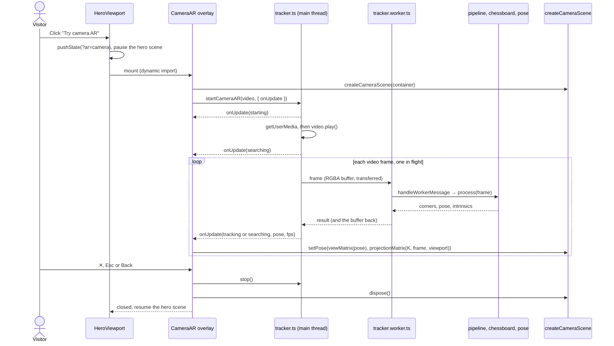

# 设计：基于标定板的摄像头 AR

状态：**已确认（2026-11-02）**，P1–P4 已完成 · 档位：Full · 分期：P1–P4，其中 P2 分两批（§10）

## 1. 目标

让任何访客都能在浏览器里用设备摄像头看到 hero 城堡立在一块真实的棋盘格上，支持 iPhone Safari、Android Chrome 和桌面电脑的摄像头。标定板就是 hero 场景和 SceneGraph AR 已在使用的 10×7 格（9×6 内角点）图案。检测和位姿估计用 TypeScript 编写（不用 OpenCV.js），在 Web Worker 中运行，驱动现有的 three.js 城堡。

不在范围内：镜头畸变校正、同时识别多块标定板、9×6 以外的标定板尺寸、录制或分享，以及现有的 WebXR 按钮（保持原样）。

## 2. 本设计依据的事实

| 事实 | 影响 |
| :--- | :--- |
| 已发布的 opencv.js 构建（4.x、5.x、`@techstark/opencv-js`）都没有导出 `findChessboardCorners`、`findChessboardCornersSB` 或 `cornerSubPix` | 检测和亚像素细化用 TypeScript 实现（决策 Q1） |
| iOS Safari 不支持 WebXR；在 HTTPS 下 `getUserMedia` 可用 | 摄像头 AR 用 `getUserMedia` 加自研追踪实现，不走 WebXR |
| 访问摄像头需要安全上下文（HTTPS 或 localhost） | Vercel 生产环境可用；局域网内的 `http://` 开发地址无法打开手机摄像头 |
| 站点是静态导出（`output: "export"`） | 一切都在客户端运行；可打印 PDF 是一个 `force-static` 的 GET 路由处理器，与 `og.png` 相同 |
| hero 位于 `Reveal` 内，`Reveal` 会对 `y` 方向的 transform 做动画 | 放在其中的 `position: fixed` 全屏叠层会相对这个祖先元素定位，因此全屏叠层通过 portal 挂到 `document.body` |
| Next.js 16 把 `window.history.pushState` 接入了自身路由 | 全屏叠层的打开状态放在 URL 里（`?ar=camera`、`?ar=board`），这样按返回键即可关闭，二维码链接也能直接打开它 |

## 3. 决策

2026-11-02 已确认：

| # | 决策 |
| :--- | :--- |
| Q1 | 纯 TypeScript 实现的检测器和平面 PnP |
| Q2 | hero 中的一个按钮打开全屏叠层 |
| Q3 | 屏幕上显示的标定板、可打印 PDF，以及从桌面端交接到手机的二维码 |

2026-11-02 还确认了以下细节，各项均采用方案 A：

| # | 细节 | A（采用） | B（否决） |
| :--- | :--- | :--- | :--- |
| D1 | 焦距 | 根据标定板估计：取最近若干次估计值的中位数，视场角限定在 40–100°，初始为 60° | 固定 60° 水平视场角 |
| D2 | 前置摄像头画面 | 不镜像 | 像自拍一样镜像（用 CSS 翻转视频和画布） |
| D3 | 标定板丢失 | 保留最后一个位姿 0.5 s，然后隐藏城堡 | 立即隐藏城堡 |
| D4 | 用哪个摄像头 | 有后置摄像头就用后置，否则用默认摄像头；不提供切换按钮 | 增加前/后置切换按钮 |
| D5 | 桌面端的首个界面 | 桌面端（无 coarse pointer）打开带二维码的标定板界面；手机和平板打开摄像头 | 总是先打开摄像头 |
| D6 | 从二维码进入 | 立即启动摄像头（由浏览器请求权限） | 先显示一个开始按钮 |
| D7 | 位姿读数 | 以米为单位，假定格子边长 25 mm，并注明这一假定 | 以标定板格数为单位 |
| D8 | 可打印标定板 | A4 横向 PDF | SVG |
| D9 | WebXR 按钮 | 摄像头 AR 按钮和 WebXR 按钮都显示 | 在支持 WebXR AR 的环境中隐藏摄像头 AR |
| D10 | 无法访问摄像头的浏览器 | 隐藏摄像头 AR 按钮 | 显示按钮，点击后给出说明 |
| D11 | 全屏叠层上的标注 | 在真实标定板上显示 OpenCV 风格的角点连线和坐标轴 | 只显示城堡 |
| D12 | 真实照片测试样本 | 由你提供 5–10 张打印标定板的照片 | 只用合成图像 |
| D13 | 减弱动态效果 | 摄像头 AR 仍可用；关闭扫描环动画 | 与正常模式相同 |
| D14 | 按钮位置 | hero 视口右下角，排在 WebXR 按钮之前；那里不再显示 "move the pointer" 提示 | 右上角，紧挨 FPS 读数；提示保留 |

测试计划提出的待定问题 OQ-01–OQ-60 已于当天全部定案。§14 列出各项结论；它们属于本契约，并细化 §5–§11 中的表述。

## 4. 模块

| 模块 | 职责 | 不得依赖 | 分期 |
| :--- | :--- | :--- | :--- |
| `src/ar/board.ts` | 标定板几何常量和内角点坐标 | 图像、three.js、DOM | P1 |
| `src/ar/chessboard.ts` | RGBA 转灰度、内角点检测、排序、亚像素细化、追踪提示 | 内参、位姿、three.js、DOM | P1 |
| `src/ar/pose.ts` | 内参模型、平面 PnP、焦距估计，以及用普通数组表示的 three.js 视图矩阵和投影矩阵 | 图像、DOM、运行时的 three.js | P2 |
| `src/ar/pipeline.ts` | 逐帧处理（灰度 → 检测 → 平滑 → 焦距 → 位姿）、角点滤波器、焦距追踪器、worker 消息处理 | DOM、Worker 全局对象、three.js | P2 |
| `src/ar/tracker.worker.ts` | Worker 入口：把消息转发给 `handleWorkerMessage` | 流水线以外的一切 | P2 |
| `src/ar/tracker.ts` | 主线程：摄像头流、帧采集、worker 循环（同时只有一帧在途）、状态机、fps | three.js、React、检测内部实现 | P3 |
| `src/components/heroScene.ts` | （已有）城堡场景；新增 `createCameraScene` 和 `setPaused` | 摄像头、检测 | P3 |
| `src/components/CameraAR.tsx` | 全屏叠层 UI：摄像头界面、HUD、错误、关闭；之后加入标定板界面和二维码 | 检测内部实现 | P3、P4 |
| `src/components/HeroViewport.tsx` | （已有）入口按钮、与 URL 同步的打开状态、懒加载全屏叠层、暂停 hero 场景 | 检测内部实现 | P3、P4 |
| `src/app/chessboard.pdf/route.ts` | 构建时生成标定板的 A4 PDF | 其他一切 | P4 |
| `src/data/profile.ts` | （已有）按钮和全屏叠层的 zh、en 文案 | — | P3、P4 |

依赖只朝一个方向：`chessboard → board`；`pipeline → chessboard, pose, board`；`tracker.worker → pipeline`；`tracker → pipeline (types only)`；`CameraAR → tracker, pose, heroScene`；`HeroViewport → CameraAR (dynamic import), heroScene`；`heroScene → board`。`src/ar/` 中除 `tracker.ts` 外都不依赖 DOM，因此既能在 Node 中跑测试，也能在 worker 中运行。worker 从不导入 `heroScene.ts`，因此 three.js 不会进入 worker 包。

## 5. 接口契约

### 5.1 `src/ar/board.ts`（P1）

```ts
export const BOARD: {
  readonly squaresX: 10; readonly squaresY: 7;  // squares along the long and short side
  readonly cornersX: 9; readonly cornersY: 6;   // inner corners
  readonly squareSize: 0.24;                    // scene units per square (heroScene's SQUARE)
  readonly squareMeters: 0.025;                 // printed square size
};

/** Board-plane coordinates (X, Y) of every inner corner in detector order. */
export function boardCorners(): Float64Array;
```

- 布局：对 r ∈ [0, 7)、c ∈ [0, 10)，格子 (r, c) 当且仅当 r + c 为偶数时为深色，因此格子 (0, 0) 是深色。内角点 (i, j) 是格子 (j, i)、(j, i+1)、(j+1, i) 和 (j+1, i+1) 的公共顶点。
- `boardCorners()` 返回长度为 2 · 9 · 6 的新数组。角点 k = j · 9 + i 存放在 [2k, 2k+1]，其中 X = (i + 1 − 10/2) · 0.24，Y = (j + 1 − 7/2) · 0.24。因此角点 0 为 (−0.96, −0.6)，角点 53 为 (0.96, 0.6)，质心为 (0, 0)。
- heroScene 的 `COLS`、`ROWS` 和 `SQUARE` 取自 `BOARD`，所以虚拟标定板和检测到的标定板不会对不上。

### 5.2 `src/ar/chessboard.ts`（P1）

```ts
export interface GrayImage {
  readonly width: number;
  readonly height: number;
  readonly data: Uint8Array | Uint8ClampedArray; // row-major, one byte per pixel
}

export function rgbaToGray(
  rgba: Uint8Array | Uint8ClampedArray, width: number, height: number, out?: Uint8Array,
): GrayImage;

export interface DetectOptions {
  /** Corners found in the previous frame, same layout as the result. A hint only. */
  readonly previous?: Float32Array | null;
}

export function findChessboardCorners(
  image: GrayImage, cornersX: number, cornersY: number, options?: DetectOptions,
): Float32Array | null;
```

`rgbaToGray`
- 按 BT.601 计算灰度：Grey = 0.299 R + 0.587 G + 0.114 B，忽略 alpha；每个输出值与精确值取整后的结果相差不超过 1。
- 传入 `out` 时，结果写入 `out` 并作为 `data` 返回。
- 以下情况抛出 `RangeError`：width 或 height 不是正整数；`rgba.length ≠ 4 · width · height`；`out` 长度不对。

`findChessboardCorners`
- 前置条件（不满足则抛出 `RangeError`）：`image.data.length = width · height`，且尺寸为正整数；`cornersX` 和 `cornersY` 是 ≥ 2 的整数，二者不相等，且和为奇数（这样棋盘的黑白分布才能区分相差 180° 旋转的两种朝向；9 + 6 满足）；若给出 `previous`，其长度为 2 · cornersX · cornersY。
- 结果：长度为 2 · cornersX · cornersY 的新 `Float32Array`。角点 k = j · cornersX + i 存放在 [2k, 2k+1]。坐标单位为像素，像素 (u, v) 的中心位于 (u, v)，因此图像范围为 [−0.5, width − 0.5] × [−0.5, height − 0.5]。
- 排序规则，三条合起来保证结果唯一：
  - **O1** i 沿有 cornersX 个角点的那条边变化，j 沿有 cornersY 个角点的那条边变化。
  - **O2** 不镜像：cross(p(1,0) − p(0,0), p(0,1) − p(0,0)) > 0，其中 cross(a, b) = a.x · b.y − a.y · b.x，图像 y 轴朝下。
  - **O3** 从角点 0 沿对角线向外的那个格子是深色（即 §5.1 中的格子 (0, 0)）。
- 适用范围：下面的精度、拒绝和追踪保证适用于 (cornersX, cornersY) = (9, 6) 和 (6, 9)。其他满足前置条件的尺寸同样接受，但只保证拒绝条款 (d)（OQ-09）。§14 的 OQ-07–OQ-17 对下面各条做了细化。
- **标称条件**下的精度：整块标定板（含最外圈格子）连同至少 0.25 格的浅色边距都在图像内；投影后每条格子边长 ≥ 12 px；倾角（标定板法线与指向标定板中心的视线之间的夹角）≤ 60°；面内旋转任意；高斯模糊 σ ≤ 1.0 px；加性高斯噪声 σ ≤ 4 个灰度级；深浅对比度 ≥ 80 个灰度级；整块板上的线性光照梯度不超过 ±25 %。满足这些条件时，结果非 null、满足 O1–O3，且相对真值的角点 RMS 误差 ≤ 0.25 px、最大误差 ≤ 0.6 px。
- 拒绝（返回 `null`）：(a) 图像中没有标定板（纯色、噪声、渐变、随机矩形、类似文字的纹理）；(b) 任一内角点在图像外；(c) 任一内角点被遮挡；(d) 可见角点网格的尺寸与请求的不同，无论更大还是更小。若有内角点距图像边界不到 3 px，结果可以是 `null`，也可以是满足精度要求的结果。绝不返回尺寸错误或顺序错误的角点网格：宁可返回 `null`，也不给出错误答案。
- 追踪提示：`previous` 不会改变正确答案的标准。无论 `previous` 是正确的、过期的还是无效数据，结果都满足与不传时相同的保证。当 `previous` 是上一帧的角点，且标定板此后移动 ≤ 0.25 格时，标称条件下结果非 null。
- 确定性：相同输入得到相同输出。函数不修改输入。
- 性能（在 §9 中检查，不是硬性契约）：在桌面 CPU 上用 Node 处理 640×360 帧，中位耗时 ≤ 30 ms，有有效 `previous` 时 ≤ 5 ms；手机上 640×360 时每秒至少 20 个结果。

### 5.3 `src/ar/pose.ts`（P2）

```ts
export interface Size { readonly width: number; readonly height: number }
/** Pinhole intrinsics in pixels, pixel-centre convention (§6). */
export interface Intrinsics { readonly fx: number; readonly fy: number; readonly cx: number; readonly cy: number }
/** Board frame → OpenCV camera frame. R is 3×3 row-major; t is the board origin in camera coordinates, board units. */
export interface Pose { readonly R: Float64Array; readonly t: Float64Array; readonly rms: number }

export function intrinsicsFromFov(width: number, height: number, hfovDeg: number): Intrinsics;
export function solvePlanarPnP(objectXY: ArrayLike<number>, imageXY: ArrayLike<number>, K: Intrinsics): Pose | null;
export function estimateFocal(objectXY: ArrayLike<number>, imageXY: ArrayLike<number>, width: number, height: number): number | null;
export function viewMatrix(pose: Pose): Float64Array;
export function projectionMatrix(K: Intrinsics, image: Size, viewport: Size, near: number, far: number): Float64Array;
export function cameraPosition(pose: Pose): Float64Array;
```

`intrinsicsFromFov`：fx = fy = (width / 2) / tan(hfov / 2)，cx = (width − 1) / 2，cy = (height − 1) / 2。width 或 height ≤ 0，或 hfovDeg ∉ (0, 180) 时抛出 `RangeError`。

`solvePlanarPnP`
- 前置条件（不满足则抛出 `RangeError`）：两个数组长度相同，都是偶数 2N 且 N ≥ 4；所有值都是有限数；内参都是有限数，且 fx, fy > 0。物体点位于标定板平面 Z = 0 上。
- 问题退化时返回 `null`：物体点或像点中找不到 4 个处于一般位置（任意三点不共线）的点（像点见 OQ-61），或不存在标定板完全位于相机前方的有限解（OQ-67）。如果标定板上的点都在相机前方、但板坐标原点不在，也返回 `null`，以保证 t_z > 0；只有物点离原点很远时才会出现这种情况，而 `boardCorners()` 以原点为中心（OQ-69）。
- 后置条件：R 为正交矩阵（max |RᵀR − I| ≤ 1e−9）且 det R = +1；t_z > 0；`rms` 是 `imageXY` 与 K(R · [X Y 0]ᵀ + t) 之间像素距离平方的均值的平方根。
- 精度：对精确投影，旋转误差 ≤ 1e−6 rad，且 |t − t_true| ≤ 1e−6 · |t_true|（适用范围见 OQ-19）。54 个角点加 σ = 0.3 px 噪声、标定板至少占图像宽度的三分之一、使用真实 K 时，20 次固定种子试验中的每一次：倾角 35–60° 时旋转误差 ≤ 0.5°，倾角 0–35° 时 ≤ 3°，因为接近正对相机的平面目标对旋转的约束较弱（OQ-18）；倾角 0–60° 时平移误差 ≤ |t_true| 的 1 %。
- 最终位姿使像素重投影误差最小，因此其 `rms` 不大于仅用单应矩阵得到的估计的 `rms`。

`estimateFocal`
- 根据标定板到图像的单应矩阵估计焦距（单位为像素），假设像素为正方形、偏斜（skew）为零、主点位于 ((width − 1) / 2, (height − 1) / 2)。`RangeError` 规则与 `solvePlanarPnP` 相同，另外要求 width 和 height 为正。
- 这里的倾角指标定板法线与相机光轴之间的夹角（OQ-23）。以下保证都假设真实水平视场角在 40–100° 之间，即 D1 的限幅范围（OQ-62）。视角接近正对相机时返回 `null`：倾角 < 10° 时，数据精确则无论标定板多大都返回 `null`，噪声 σ ≤ 0.3 px 时只要标定板至少占图像宽度 40 % 也返回 `null`（OQ-62）；倾角在 10–25° 时可能返回 `null`。倾角 25–60°、数据精确或噪声 σ ≤ 0.3 px、且标定板至少占图像宽度 40 % 时，一定返回数值（OQ-24）。超出这些条件时，可能返回 `null`，也可能返回数值。点集退化时（OQ-25），以及估计值不是有限正数时，也返回 `null`。
- 精度：精确数据、倾角 ≥ 30° 时，与真实焦距相差不超过 1 %。σ = 0.3 px 噪声、倾角 45°、标定板至少占图像宽度的 40 % 时：20 次固定种子试验中，每次都在 10 % 以内。
- 尺度不变：所有物点乘以同一个因子 s > 0 后，估计值的相对变化不超过 1e−9，精确数据和带噪声数据都一样（OQ-63）。

`viewMatrix`：返回新的 16 元素列主序矩阵 V（元素顺序同 `THREE.Matrix4`），使得对任意场景点 p = (x, y, z)，V · [p, 1] = [F · (R · B · p + t), 1]。其中 B = [[1, 0, 0], [0, 0, 1], [0, −1, 0]] 把场景坐标映射为标定板坐标，F = diag(1, −1, −1) 把 OpenCV 相机坐标映射为 three.js 相机坐标（§6）。

`projectionMatrix`：返回供 three.js 使用的新 16 元素列主序矩阵 P。视口 W × H 按 CSS `object-fit: cover` 的方式显示 w × h 的分析图像（统一缩放 s = max(W / w, H / h)，居中）；OpenCV 相机坐标为 (X, Y, Z)、Z > 0 的点经 P 变换和透视除法后，正好落在它在该视口中显示的位置：
- x_ndc = (2 s fx / W) · (X / Z) + (s / W) · (2 cx + 1 − w)
- y_ndc = −(2 s fy / H) · (Y / Z) − (s / H) · (2 cy + 1 − h)
- 深度：near 映射到 −1，far 映射到 +1（OpenGL 约定）。

尺寸不是有限正数、K 含非有限值或 fx、fy ≤ 0（OQ-70），或 near、far 不是满足 0 < near < far 的有限数时，抛出 `RangeError`（OQ-22、OQ-64）。

`cameraPosition`：相机中心在场景坐标中的位置 B⁻¹ · (−Rᵀ t)，以新的 3 元素数组返回。HUD 把它换算为米（× 0.025 / 0.24）和偏航角（atan2(x, z)，单位为度），与 hero 场景现在的做法相同。

### 5.4 `src/ar/pipeline.ts` 和 `src/ar/tracker.worker.ts`（P2）

```ts
export interface FrameInput { readonly width: number; readonly height: number; readonly rgba: Uint8ClampedArray; readonly time: number } // time in ms
export interface FrameOutput {
  readonly found: boolean;
  readonly corners: Float32Array | null;   // smoothed corners, detector layout
  readonly pose: Pose | null;
  readonly intrinsics: Intrinsics;         // the intrinsics the pose was solved with
  readonly ms: number;                     // processing time
}
export interface PipelineOptions {
  readonly hfovDeg?: number;               // default 60
  readonly autoFocal?: boolean;            // default true (D1)
  readonly smoothing?: boolean;            // default true
}
export function createPipeline(options?: PipelineOptions): { process(frame: FrameInput): FrameOutput; reset(): void };

export interface CornerFilterOptions { readonly minCutoff?: number; readonly beta?: number; readonly dCutoff?: number } // One Euro, Hz
export function createCornerFilter(options?: CornerFilterOptions): {
  apply(corners: Float32Array, time: number): Float32Array;
  reset(): void;
};

export interface FocalTrackerOptions {
  readonly hfovDeg: number;
  readonly minFovDeg?: number;             // default 40
  readonly maxFovDeg?: number;             // default 100
  readonly window?: number;                // default 15
  readonly minSamples?: number;            // default 5
}
export function createFocalTracker(options: FocalTrackerOptions): {
  add(estimate: number | null): void;
  focal(width: number): number;
  reset(): void;
};

export type WorkerRequest =
  | { readonly type: "frame"; readonly id: number; readonly width: number; readonly height: number; readonly buffer: ArrayBuffer; readonly time: number }
  | { readonly type: "reset" };
export type WorkerResponse =
  | { readonly type: "result"; readonly id: number; readonly found: boolean; readonly corners: Float32Array | null;
      readonly pose: { readonly R: number[]; readonly t: number[]; readonly rms: number } | null;
      readonly intrinsics: Intrinsics; readonly ms: number; readonly buffer: ArrayBuffer }
  | { readonly type: "error"; readonly id: number; readonly message: string };
export function handleWorkerMessage(
  pipeline: ReturnType<typeof createPipeline>, message: WorkerRequest,
): { reply: WorkerResponse; transfer: Transferable[] } | null;
```

`createPipeline().process(frame)`
1. 若某帧的宽或高与上一帧不同，先重置全部状态，再处理这一帧。
2. 转为灰度并调用 `findChessboardCorners(gray, 9, 6, { previous })`，其中 `previous` 是上一帧的原始（未平滑）角点。
3. 未找到：`found` 为 false，`corners` 和 `pose` 为 null，重置角点滤波器，`intrinsics` 取焦距追踪器的当前值。
4. 找到：开启 `autoFocal` 时，把 `estimateFocal(boardCorners(), raw, width, height)` 加入焦距追踪器。K = { fx = fy = tracker.focal(width), cx = (width − 1) / 2, cy = (height − 1) / 2 }。开启 `smoothing` 时对角点做平滑。平滑用默认参数的 `createCornerFilter()`；焦距追踪器是 `createFocalTracker({ hfovDeg })`，hfovDeg 取流水线的 `hfovDeg`，其他选项用默认值（OQ-75）。`pose = solvePlanarPnP(boardCorners(), smoothed, K)`；若它返回 `null`，该帧按未找到处理。
5. 流水线不保留对其返回数组的引用，因此调用方可以转移（transfer）这些数组。相同的帧序列总是得到相同的输出（`ms` 除外）。
6. `reset()` 清除追踪、平滑和焦距状态。

`createCornerFilter`：对每个坐标分量独立应用 One Euro filter（默认 minCutoff 1.0、beta 0.05、dCutoff 1.0；截止频率单位为 Hz，`time` 与 `FrameInput.time` 一样以毫秒为单位，OQ-01）。
- 以下三种调用都返回输入的副本，并以它为起点重新开始滤波：创建或 `reset()` 后的第一次调用；数组长度与上一次调用不同的调用；time 不晚于上一次调用的调用。
- 静止标定板、30 fps、σ = 0.3 px 抖动：前 10 帧之后，输出的标准差 ≤ 输入标准差的 0.5 倍。
- 30 fps 下出现 ≥ 12 px 的阶跃：6 帧内输出与新位置的距离在 0.5 px 以内。
- 每次调用都返回新数组，从不修改输入。

`createFocalTracker`
- `focal(width)`：在加入 `minSamples` 个非 null 估计之前，返回 (width / 2) / tan(hfovDeg / 2)。此后返回最近 `window` 个非 null 估计的中位数，并限定在该宽度下 `maxFovDeg` 与 `minFovDeg` 对应的焦距之间。
- `add(null)` 会被忽略；`reset()` 清空所有估计。

`handleWorkerMessage`
- `frame`：把 `buffer` 包装为 RGBA，调用 `process`，回复 `result`：其中携带输出，并交还同一个 `buffer`，供主线程复用。`transfer` 包含这个 buffer 和角点数组的 buffer。
- `reset`：调用 `pipeline.reset()`，返回 `null`。
- 其他类型的消息返回 `null`。`process` 抛出的异常转为 `{ type: "error", id, message }`，transfer 列表为空。

`tracker.worker.ts` 只把 `self.onmessage` 接到 `handleWorkerMessage`，并连同 transfer 列表发回回复。

### 5.5 `src/ar/tracker.ts`（P3）

```ts
export type CameraError = "insecure" | "unsupported" | "denied" | "no-camera" | "failed";
export type TrackingStatus = "starting" | "searching" | "tracking" | "error";
export interface TrackingUpdate {
  readonly status: TrackingStatus;
  readonly error: CameraError | null;       // non-null only when status is "error"
  readonly pose: Pose | null;               // non-null only when status is "tracking"
  readonly intrinsics: Intrinsics | null;
  readonly frame: Size | null;              // analysis frame size that pose and intrinsics refer to
  readonly fps: number;                     // worker results in the last 1000 ms
}
export interface WorkerLike {
  postMessage(message: WorkerRequest, transfer?: Transferable[]): void;
  onmessage: ((event: { data: WorkerResponse }) => void) | null;
  onerror: ((event: unknown) => void) | null;
  terminate(): void;
}
export interface VideoLike {
  srcObject: MediaStream | null;
  readonly videoWidth: number;
  readonly videoHeight: number;
  play(): Promise<void>;
}
export interface CameraARDeps {
  readonly isSecureContext: boolean;
  readonly mediaDevices: { getUserMedia(constraints: MediaStreamConstraints): Promise<MediaStream> } | undefined;
  createWorker(): WorkerLike;
  /** Draws the current video frame scaled to width × height into `out` (RGBA). */
  captureFrame(video: VideoLike, width: number, height: number, out: Uint8ClampedArray): void;
  /** Calls back once on the next video frame; returns a cancel function. */
  requestFrame(video: VideoLike, callback: () => void): () => void;
  now(): number;
}
export interface CameraAROptions {
  onUpdate(update: TrackingUpdate): void;
  readonly facingMode?: "environment" | "user";   // default "environment" (D4)
  readonly analysisLongSide?: number;             // default 640
  readonly holdMs?: number;                       // default 500 (D3)
}
export function startCameraAR(video: VideoLike, options: CameraAROptions, deps?: Partial<CameraARDeps>): { stop(): void };
```

- **B1** 第一个更新 `starting` 在 `startCameraAR` 内同步发出。
- **B2** 没有安全上下文时，下一个更新为 `error` / `insecure`，且始终不调用 `getUserMedia`；没有 `mediaDevices.getUserMedia` 时为 `error` / `unsupported`。
- **B3** `getUserMedia` 只调用一次，参数为 `{ audio: false, video: { facingMode: { ideal: facingMode }, width: { ideal: 1280 }, height: { ideal: 720 } } }`。
- **B4** 拒绝按错误的 `name` 映射：`NotAllowedError` 和 `SecurityError` → `denied`；`NotFoundError` 和 `OverconstrainedError` → `no-camera`；其他 → `failed`。`play()` 被拒绝、worker 回复 `error`、worker 触发 `onerror` 事件，也都以 `error` / `failed` 结束。错误是终态：释放资源，之后不再有更新。
- **B5** 流挂到 `video.srcObject` 上且 `play()` resolve 之后，更新为 `searching`，开始处理帧。
- **B6** 一帧在途：上一帧的回复到达之前，绝不发送新帧。分析尺寸的长边为 min(analysisLongSide, 视频长边)，保持视频的宽高比，并取整。`videoWidth` 或 `videoHeight` 为 0 时跳过帧。随回复交还的 RGBA buffer 复用于下一个同尺寸的帧。
- **B7** 每个回复产生一个更新。找到：`tracking`，带上回复中的位姿、内参和帧尺寸。未找到，但距上一次找到的回复不超过 `holdMs`：仍为 `tracking`，沿用上一次的位姿。其他情况：`searching`，`pose` 为 null。
- **B8** `fps` 统计按 `deps.now()` 计时、最近 1000 ms 内收到的回复数。
- **B9** `stop()` 停止流的所有 track，终止 worker，取消挂起的帧回调，并屏蔽之后的所有更新。它是幂等的。若在 `getUserMedia` resolve 之前调用，则在其 resolve 后立即停止流的所有 track。

只有 `deps` 没有提供某个依赖时才解析其默认值，因此传入全部依赖的调用方永远不会访问 `window` 或 `navigator`（OQ-02）。浏览器中的默认值：`window.isSecureContext`；`navigator.mediaDevices`；`new Worker(new URL("./tracker.worker.ts", import.meta.url), { type: "module" })`；一个复用的 canvas（`willReadFrequently: true`），配合 `drawImage` 和 `getImageData`；支持时用 `video.requestVideoFrameCallback`，否则用 `requestAnimationFrame`；`performance.now`。

### 5.6 `src/components/heroScene.ts` 新增内容（P3）

```ts
// existing, extended
export function createHeroScene(container: HTMLElement, options: { reducedMotion: boolean; onStats(stats: Stats): void }): {
  enterXR(mode: XRMode): Promise<void>;
  setPaused(paused: boolean): void;
  dispose(): void;
};
// new
export function createCameraScene(container: HTMLElement, options: { reducedMotion: boolean }): {
  setPose(view: ArrayLike<number> | null, projection: ArrayLike<number> | null): void;
  dispose(): void;
};
```

- `setPaused(true)` 无论 hero 是否可见都会停止其动画循环；`setPaused(false)` 恢复现有的、由可见性驱动的行为。进行中的 XR 会话不受影响。
- `createCameraScene` 在铺满容器的透明 canvas 上绘制，包含与 hero 相同的城堡、角点标记、坐标轴、团状阴影（blob shadow）和扫描环，用相同的辅助函数构建；不包含虚拟标定板模型、浮尘、地面网格、指针控制视角和 WebXR。
- `setPose(view, projection)`：`view` 非 null 时显示场景内容，相机原样使用传入的矩阵（列主序，来自 `pose.ts`）。`view` 为 null 时隐藏场景内容。
- 挂载期间持续渲染；减弱动态效果时关闭扫描环动画（D13）。`dispose()` 释放 GPU 资源并移除 canvas。

### 5.7 UI 行为（`CameraAR.tsx`、`HeroViewport.tsx`）

入口（未标注的为 P3）：
- **U1** 当 `window.isSecureContext` 与 `navigator.mediaDevices?.getUserMedia` 均存在时（D10），hero 视口中显示「用摄像头看 AR」按钮，位置见 D14。
- **U2** 点击按钮会向历史记录 push `?ar=camera` 并打开全屏叠层；从 P4 起，桌面端（无 coarse pointer）改为 push `?ar=board`（D5）。带 `?ar=camera` 或 `?ar=board` 加载页面时直接打开全屏叠层（D6）。返回（不带该参数的 `popstate`）、✕ 和 Esc 都会关闭它。用 ✕ 或 Esc 关闭时，如果这条历史记录是全屏叠层自己 push 的，就调用 `history.back()`，否则把 URL 替换为去掉该参数的版本。
- **U3** 全屏叠层打开期间，hero 场景暂停，页面不能滚动。关闭后焦点回到入口按钮。
- **U4** 全屏叠层的代码（tracker、pose、场景胶水代码、二维码库）只在全屏叠层打开时加载；首页 bundle 只增加按钮本身。

摄像头界面（P3）：
- **U5** 全屏显示在所有页面内容之上：一个 `object-fit: cover` 的 `<video playsinline muted autoplay>`，上面叠放场景 canvas，使用同样的 cover 映射（`projectionMatrix`）。不镜像（D2）。
- **U6** HUD 沿用现有风格（`HudCorners`、等宽数字）：一行状态——starting 时为「正在打开摄像头…」，searching 时为「对准一块 10×7 棋盘格」，tracking 时为「追踪中 · 54 个角点」；追踪的 fps；追踪期间显示相机相对标定板中心的位置，格式为 "x … y … z … m · …°"，单位为米（按 25 mm 格子计算），并附说明（D7）。
- **U7** 每种错误（insecure、unsupported、denied、no-camera、failed）都会把状态行替换为一句简短说明和一个关闭操作；`denied` 还会说明如何重新允许访问摄像头。从 P4 起，错误状态还提供 "Show the board instead"。
- **U8** 设置 `role="dialog"`、`aria-modal="true"` 和无障碍名称；打开时焦点移到关闭按钮（✕，带 `aria-label`）；按 Esc 关闭。

标定板界面（P4）：
- **U9** 摄像头界面增加 "Show board"（切换到标定板界面）和 "Print board (PDF)"（下载 `/chessboard.pdf`）。
- **U10** 标定板界面在白色面板上显示 10×7 标定板，四周至少留半格边距，在放得下的前提下尽量大，格子 (0, 0) 位于左上角。支持 Screen Wake Lock API 时用它保持屏幕常亮。
- **U11** 桌面端在标定板旁显示二维码，编码 `${origin}/${lang}?ar=camera`，说明文字为「用手机扫码，对准这块屏幕」。触屏设备上不显示二维码，说明文字为「用另一台设备的摄像头对准这块屏幕」。
- **U12** "Use this device's camera" 切换到摄像头界面，并把 URL 参数替换为 `camera`。

所有文案都放在 `profile.ts` 的 `ui.hud.camera`（按钮）和 `ui.hud.cameraAR`（全屏叠层）下，提供 zh 和 en 两种语言，因此 `page.tsx` 仍照旧传入 `c.ui.hud`，无需改动。

### 5.8 `src/app/chessboard.pdf/route.ts`（P4）

- `export const dynamic = "force-static"`。`GET()` 返回 `Content-Type: application/pdf` 的 `Response`，内容是一份 PDF 1.4 文档，只有一页 A4 横向页面（`/MediaBox [0 0 842 595]`，单位为 pt）。
- 页面：白色背景；10 × 7 个 25 mm（70.866 pt）的格子居中，打印出来时格子 (0, 0) 为深色且位于左上角，35 个深色格子填充黑色；标定板下方是一行不超过 10 pt 的 Helvetica 说明文字，与 `og.png` 一样用英文："SceneGraph AR board · 10×7 squares, 9×6 inner corners · 25 mm squares · print at 100% (actual size)"；另有一条 50 mm 比例尺，用于检查打印比例。
- 结构有效：以 `%PDF-1.4` 开头，交叉引用表的字节偏移正确，trailer 含 `/Root`，以 `%%EOF` 结尾。

## 6. 坐标约定

| 项目 | 约定 |
| :--- | :--- |
| 像素 | 像素 (u, v) 的中心位于 (u, v)；w × h 图像的范围为 [−0.5, w − 0.5] × [−0.5, h − 0.5]（与 OpenCV 相同） |
| OpenCV 相机 | x 向右，y 向下，z 向前 |
| three.js 相机 | x 向右，y 向上，朝 −z 方向看；F = diag(1, −1, −1) 把 OpenCV 坐标转换过来 |
| 标定板坐标系 | X 沿 i，Y 沿 j，Z = X × Y（从正面看时指向板内） |
| 场景 | 标定板位于 y = 0 平面；标定板 X = 场景 x，标定板 Y = 场景 z，标定板 Z = −场景 y，由此得到 B |
| 单位 | 标定板和场景使用同一单位，每格 0.24；米 = 单位 × 0.025 / 0.24 |
| cover 适配 | s = max(W / w, H / h)，图像在视口中居中（§5.3） |
| 标定板在图像中的大小 | “标定板占图像宽度 x %”按 10 × 7 个格子的外边缘量；54 个内角点只占其中的 80 %（OQ-65） |

## 7. 算法说明

供实现参考，不属于契约。

检测器（`chessboard.ts`）：
1. 对灰度图做高斯模糊（σ ≈ 1）。
2. 鞍点响应：由二阶差分计算 −det(Hessian)，或用 ChESS 环形响应。高于自适应阈值的局部极大值作为候选点，每个候选点带有极性（哪条对角线是深色）。
3. 每个候选点的两个边缘方向取自其周围环形区域内的梯度方向直方图（两个峰值，模 180°）。
4. 从强种子点生长角点网格：沿两个边缘方向步进到最近的兼容候选点（极性相反、间距一致）；用二次外推整行整列地生长，在局部间距约 0.3 倍的范围内吸附到候选点；只有一行或一列的每个点都吸附成功，才加入该行或该列。
5. 只接受恰好为 cornersX × cornersY 的角点网格（横竖两种朝向均可）；用单应矩阵拟合和极性交替来验证。
6. 仿照 `cornerSubPix` 做亚像素细化（在约 min(5 px, 0.3 × 间距) 的窗口内，基于梯度正交性做最小二乘），最多迭代 10 次，某次迭代使角点移动不到 0.01 px 时停止。
7. 排序：必要时转置，使 i 沿 cornersX 方向；角点网格镜像时翻转 i（O2）；若应为深色的格子平均比应为浅色的格子更亮，则旋转 180°（O3）。
8. 追踪：有 `previous` 时，就地细化上一帧的每个角点，然后验证（间距、单应矩阵残差、极性、颜色检查）；任一项失败就运行完整检测器。

位姿（`pose.ts`）：归一化 DLT 求单应矩阵（Hartley 归一化）→ 用 K⁻¹ 分解 → 正交化 R（极分解）→ 强制 t_z > 0 → 对 (旋转向量, t) 做 Gauss–Newton 或 Levenberg–Marquardt 优化，直到步长可以忽略（标定板数据通常不到 10 次迭代就收敛）。9 × 9 和 3 × 3 对称特征值问题用 Jacobi 旋转求解，不依赖线性代数库。

焦距（`estimateFocal`）：在以主点为原点的像素坐标下，单应矩阵的列 h1、h2 满足 h1ᵀ ω h2 = 0 和 h1ᵀ ω h1 = h2ᵀ ω h2，其中 ω = diag(1/f², 1/f², 1)。单应矩阵用归一化（Hartley）拟合，再用最小二乘求解 1/f²，这样估计值不受物点尺度影响（OQ-63）；1/f² ≤ 0 或视角接近正对相机时拒绝。判断是否接近正对相机的方法必须在 40–100° 视场角内都成立（OQ-62）：透视项 (h31, h32) 相对其他项的大小与焦距有关，只看这个比值会误判广角画面。不知道 f 也能从以主点为原点的单应矩阵读出倾角 τ：令 A1 = h11 h12 + h21 h22，A2 = h11² + h21² − h12² − h22²，N = h11² + h21² + h12² + h22²，则 ρ = √(A1² + A2²/4) / N 满足 sin² τ = 4ρ / (1 + 2ρ)，对精确数据严格成立。有噪声时，标定板太小会使 ρ 不可靠，所以带噪声的保证要求标定板至少占图像宽度 40 %。

角点滤波器（`createCornerFilter`）：每个坐标的导数相对上一个滤波后的值计算，而不是相对上一个原始值。若按原始值计算，默认参数下无法满足 §5.4 的阶跃条款（OQ-27）。

## 8. 交互



测试用的依赖注入点：`startCameraAR` 通过 `deps` 接收依赖（媒体设备、worker 工厂、帧采集、帧调度器、时钟）；`pipeline`、`chessboard` 和 `pose` 都是纯函数或自包含的状态对象；worker 文件只是在 `handleWorkerMessage` 外面包了几行。

## 9. 测试策略

- 运行器：Vitest，`node` 环境。`npm test` 执行 `vitest run`。测试放在 `tests/ar/*.test.ts`，辅助代码放在 `tests/ar/helpers/`，测试样本放在 `tests/fixtures/`。
- P1 单元测试：`rgbaToGray`；用已知单应矩阵渲染的合成图像测试检测器（4 × 4 超采样、浅色边距、模糊、噪声、光照梯度、固定种子的随机数），覆盖 O1–O3、精度、拒绝、追踪提示、确定性和输入校验；一个性能冒烟测试，放在默认测试套件中，阈值取目标的三倍：完整检测 90 ms，有有效提示时 15 ms（OQ-05）。
- P2 单元测试：`intrinsicsFromFov`；`solvePlanarPnP`（精确投影和带噪投影）；`estimateFocal`；`viewMatrix` 和 `projectionMatrix`，与直接用 K 投影再做 cover 映射的结果对比；`cameraPosition`；角点滤波器；焦距追踪器；用小尺寸合成帧端到端测试 `createPipeline`；`handleWorkerMessage`；静态扫描 `src/ar` 中的 import，检查是否符合 §4 的依赖方向（OQ-03）。
- P3 单元测试：用假依赖测试 `startCameraAR`：状态序列、错误映射、约束参数、一帧在途、分析尺寸、buffer 复用、保持逻辑、fps、`stop()`，以及较晚 resolve 的 `getUserMedia`。
- P4 单元测试：PDF 路由的内容类型和结构、MediaBox、格子数量和尺寸、说明文字。
- 真实照片（D12）：5–10 张打印标定板的照片，用 `sips` 缩放到长边 640 px，以 JPEG 格式存放在 `tests/fixtures/board/`，用开发依赖 `jpeg-js` 解码（OQ-06），并附一份记录预期结果的清单。由于没有角点真值，对每块检测到的标定板检查 O1–O3，以及单应矩阵拟合残差 ≤ 1.5 px RMS。
- 不做自动化：WebGL 输出、摄像头权限流程、布局和 UI 文案（OQ-04）。这些在浏览器面板中检查（把 `navigator.mediaDevices.getUserMedia` 替换为渲染运动标定板的 canvas 流），并在真机上检查（iPhone Safari、Android Chrome、桌面电脑摄像头，标定板分别印在纸上和显示在屏幕上）。`npm run lint`、`npx tsc --noEmit` 和 `next build`（会打包 worker 并生成 PDF）都必须保持无报错。

## 10. 规模估算与分期

| 分期 | 源文件 | 改动行数（估） | 本期完成后的站点 |
| :--- | :--- | :--- | :--- |
| P1 检测器 | `src/ar/board.ts`、`src/ar/chessboard.ts` | ~430（实际 762） | 不变（新模块尚未使用） |
| P2a 位姿（§5.3） | `src/ar/pose.ts` | ~500（实际 597） | 不变 |
| P2b worker 流水线（§5.4） | `src/ar/pipeline.ts`、`src/ar/tracker.worker.ts` | ~300（实际 332） | 不变 |
| P3 摄像头 AR 全屏叠层 | `src/ar/tracker.ts`、`src/components/CameraAR.tsx`、`src/components/heroScene.ts`、`src/components/HeroViewport.tsx`、`src/data/profile.ts` | ~490 | 摄像头 AR 可配合打印的标定板使用 |
| P4 标定板界面、二维码、PDF | `src/components/CameraAR.tsx`、`src/components/HeroViewport.tsx`、`src/app/chessboard.pdf/route.ts`、`src/data/profile.ts` | ~180 | 功能完整 |

共约 2,350 行源代码改动，涉及 11 个文件（P1、P2 为实际行数，P3、P4 为估算），不含测试、文档和构建文件。P1 估算 430 行，实际写了 762 行，因此 P2 开工前重新估算为约 800 行，并拆成 P2a 和 P2b 两批（2026-11-02 确认），实际写了 929 行。每期都按“骨架 → 测试（Red）→ 实现（Green）→ 验证”的流程进行，并在下一期开始前停下来评审。

## 11. 假设

- 测试用 Vitest 4.1.12，运行在 `node` 环境，并以 `vite` 8.3.4 和 `jpeg-js` 作为开发依赖。Vitest 5 需要 `@types/node` ≥ 22，而项目继续使用 20。`@` 别名在 `vitest.config.mts` 中设置，不通过 `vite-tsconfig-paths`。不引入 jsdom 或 Testing Library，因为没有组件测试。
- 二维码用 `uqr` 生成（MIT 许可、无依赖；实际安装的是 0.1.3），随叠层一起打包。用它的 `encode` 得到模块矩阵，由标定板界面画成一条 SVG 路径。
- 不使用镜头畸变模型；主点取图像中心。
- 分析帧长边为 640 px；向摄像头请求 1280 × 720。
- URL 参数为 `ar`，取值为 `camera` 和 `board`。
- “桌面端”指 `matchMedia("(any-pointer: coarse)")` 不匹配。
- 全屏叠层位于导航栏之上；通过在 `<html>` 上设置 `overflow: hidden` 锁定滚动。
- worker 是用 `new URL(..., import.meta.url)` 创建的 module worker。没有主线程内的回退方案（OQ-47）：P2 用 `next build` 加一个临时引用来检查它能否被打包（OQ-60）；如果不能，由用户决定如何处理。已于 2026-11-03 在 P2b 中检查：Turbopack 通过自己的启动脚本（`turbopack-worker-*.js`）把它作为经典 worker 加载，去掉了 `type` 选项；流水线、检测器和位姿代码打进同一个 19.7 KB 的 chunk（gzip 后 8 KB），不含 three.js 和 React。在浏览器面板中，导出站点的 worker 对一帧 64 × 36 的空白帧回复了 `result`（fx 55.43，缓冲区也传了回来）。Turbopack 还会把 `tracker.worker.ts` 本身复制到 `static/media`，这份副本没有被引用；它若留在 `out` 里，会让下一次构建的类型检查失败，所以 `tsconfig.json` 现在排除了 `out`。
- 在全屏叠层之外，hero HUD 仍是模拟效果，沿用现有文案。

## 12. 风险

| 风险 | 缓解措施 |
| :--- | :--- |
| 自研检测器在真实照片上（模糊、反光、屏幕）不如 OpenCV 稳健 | 合成图像压力测试、真实照片样本（D12）、基于细化的追踪，以及宁可拒绝也不猜 |
| 手机性能 | Worker、640 px 分析帧、≤ 5 ms 的追踪路径、一帧在途 |
| 焦距未知 | 根据标定板估计并限定范围（D1），在此之前用 60° |
| Turbopack 对 worker 的打包 | 已在 P2b 中用 `next build` 加临时引用检查（OQ-60）：打包结果不含 three.js，在浏览器中能正常回复帧（§11）；没有回退方案，失败时交由用户决定（OQ-47） |
| iOS 的特殊行为（playsinline、autoplay、旋转） | `muted` 和 `playsinline`；帧尺寸变化时重置流水线；在 iPhone 上手动测试 |
| 拍摄显示器时的摩尔纹和反光 | 标定板界面使用大格子和白色边距；手动测试 |

## 13. 进度

- [x] P1 检测器：2026-11-02 测试全绿（84 个通过，8 个照片用例在有照片前跳过），已审阅并提交为 `claude/camera-ar` 分支上的 `b98e03c`
- [x] P2a 位姿：2026-11-02 测试全绿（45 个位姿测试全部通过；全套 129 个通过、8 个跳过），已审阅并提交到 `claude/camera-ar` 分支
- [x] P2b worker 流水线：2026-11-03 测试全绿（61 个 P2b 测试全部通过；全套 190 个通过、8 个跳过），已检查 worker 打包（OQ-60），已审阅并提交到 `claude/camera-ar` 分支
- [x] P3 摄像头 AR 全屏叠层：2026-11-04 测试全绿（41 个 P3 测试和 H-09 全部通过；全套 232 个通过、8 个跳过），lint、tsc 和构建都无报错；已在浏览器面板中用画布流代替摄像头检查（测试计划 §9）；尚待检查 M3-01、M3-11、M3-13，以及 M3-15–M3-19 的设备和标定板；在 `claude/camera-ar-p3` 分支上等待评审
- [x] P4 标定板界面、二维码、PDF：2026-11-04 测试全绿（16 个 P4 测试和 H-10 全部通过；全套 249 个通过、8 个跳过），lint、tsc 和构建都无报错，并导出了 `out/chessboard.pdf`；已在浏览器面板中检查（测试计划 §9）；尚待检查打印（M4-07）、设备上的屏幕常亮（M4-04）和手机交接（M4-08）；在 `camera-ar-p4` 分支上等待评审

## 14. 已定细节

由测试计划提出，已于 2026-11-02 定案；OQ-61–OQ-68 是编写 P2a 测试时提出的，OQ-69–OQ-70 是 P2a 评审时提出的，都在同日定案；OQ-71–OQ-75 是编写 P2b 测试时提出的，于 2026-11-03 定案。OQ-76–OQ-82 是 2026-11-04 实现 P3 时定下的，OQ-83–OQ-89 是同日实现 P4 时定下的，都待评审时确认。每一行都属于契约。

| # | 方面 | 结论 |
| :--- | :--- | :--- |
| OQ-01 | 角点滤波器 | `time` 以毫秒为单位，与 `FrameInput.time` 相同 |
| OQ-02 | 追踪器依赖 | 只有 `deps` 缺少某个依赖时才解析其默认值 |
| OQ-03 | 架构 | 用一个测试扫描 `src/ar` 中的 import，检查是否符合 §4 的依赖方向 |
| OQ-04 | UI 文案 | 手动检查，不写单元测试 |
| OQ-05 | 性能 | 冒烟测试放在默认测试套件中，阈值取目标的三倍（90 ms、15 ms） |
| OQ-06 | 照片样本 | 640 px 的 JPEG 文件，用 `jpeg-js` 解码 |
| OQ-07 | `BOARD` | 运行时用 `Object.freeze` 冻结 |
| OQ-08 | `rgbaToGray` | `out` 不得与 `rgba` 共享内存；这种情况既不支持也不测试 |
| OQ-09 | 检测器适用范围 | 保证只覆盖 (9, 6) 和 (6, 9)；其他尺寸用作拒绝条款 (d) 的负样本 |
| OQ-10 | 错误结果 | 在标称条件之外，结果长度不对、违反 O1–O3，或任一角点与真值的距离超过 0.3 × 局部间距，即为错误结果。绝不返回错误结果 |
| OQ-11 | 边界带 | 内角点距图像边界 3 px 以内（边界内外均算）时，结果可以是 `null`，也可以是精确结果。最外圈格子被截掉的标定板不要求检出 |
| OQ-12 | 对比度 | 在施加光照梯度之后逐点测量；边距的灰度与浅色格子相同 |
| OQ-13 | 遮挡 | 遮挡物覆盖某个内角点及其周围至少 0.3 格的范围，或破坏了该角点时，返回 `null`；其他遮挡可以返回 `null`，也可以返回精确结果 |
| OQ-14 | 两块标定板 | 返回 `null`，或返回其中一块且满足各项保证 |
| OQ-15 | 追踪提示 | “移动 ≤ 0.25 格”指每个角点在图像中的位移都 ≤ 0.25 × 最短的格子边长；提示不会放宽标称条件 |
| OQ-16 | 无标定板的帧 | 耗时目标与有标定板的帧相同 |
| OQ-17 | 结果的 buffer | 结果独占一个大小恰好等于其长度的 buffer |
| OQ-18 | 带噪声的 PnP | 倾角 35–60° 时旋转误差 ≤ 0.5°，倾角 0–35° 时 ≤ 3°（§5.3） |
| OQ-19 | 精确数据上的 PnP | 1e−6 的误差界适用于带噪测试的条件范围，外加一组 4 点数据 |
| OQ-20 | PnP 退化 | 除非存在 4 个任意三点不共线的点，否则视为退化 |
| OQ-21 | 标定板在相机后方 | 若对应点只能由位于相机后方的标定板解释，则返回 `null` |
| OQ-22 | 位姿输入校验 | 非有限数抛出 `RangeError`；允许非整数尺寸；`viewMatrix` 和 `cameraPosition` 不做校验 |
| OQ-23 | 焦距估计中的倾角 | 标定板法线与光轴之间的夹角 |
| OQ-24 | 焦距估计返回数值的条件 | 精确数据或 σ ≤ 0.3 px 的数据，标定板 ≥ 图像宽度的 40 %，倾角 25–60° |
| OQ-25 | 焦距估计退化 | 退化点集返回 `null` |
| OQ-26 | 投影矩阵 | Z > 0 时裁剪坐标 w > 0，且 P 可逆 |
| OQ-27 | One Euro 的具体公式 | 只有行为条款属于契约；具体公式见 §7 |
| OQ-28 | 抖动的度量 | 按坐标分量分别统计，范围为第 11–300 帧 |
| OQ-29 | 阶跃条款 | 无噪声；按每个角点的欧氏距离计算；从第 6 个输出起成立 |
| OQ-30 | 中位数 | 个数为偶数时，取中间两个值的平均 |
| OQ-31 | 焦距追踪器输入 | NaN、±Infinity、0 和负的估计值与 `null` 一样被忽略 |
| OQ-32 | 选项 | 无效选项在创建或启动时抛出 `RangeError` |
| OQ-33 | PnP 失败 | 检测成功但 PnP 失败时，该帧的原始角点仍作为下一帧的提示 |
| OQ-34 | 未找到时的内参 | 与第 4 步一样，由焦距追踪器构造 |
| OQ-35 | 格式错误的帧 | 抛出 `RangeError`；流水线状态不变 |
| OQ-36 | Worker 错误文本 | 是 `Error` 时取其 `message`，否则取 `String(value)`；非对象消息返回 `null` |
| OQ-37 | 更新字段 | 收到第一个回复后，无论处于什么状态，`intrinsics` 和 `frame` 都取最新回复的值 |
| OQ-38 | 保持边界 | “`holdMs` 以内”包含边界（≤）；保持期间的更新沿用上一次找到时那条回复的内参和帧尺寸 |
| OQ-39 | fps 窗口 | 统计距今不足 1000 ms 的回复，包括当前这条 |
| OQ-40 | 早期错误 | `insecure` 和 `unsupported` 在 `startCameraAR` 返回之后、晚一个微任务发出 |
| OQ-41 | `play()` 被拒绝 | 总是 `failed` |
| OQ-42 | 依赖抛出异常 | 转为 `failed`，并释放资源 |
| OQ-43 | `stop()` 之后才到达的流 | 停止它的所有 track；不设置 `srcObject`，也不调用 `play()` |
| OQ-44 | 幂等的 `stop()` | `terminate()` 和每个 track 的 `stop()` 都恰好调用一次 |
| OQ-45 | 帧 id | 严格递增；忽略 id 不符合预期的回复 |
| OQ-46 | worker 卡死 | 不设看门狗 |
| OQ-47 | 回退方案 | 没有主线程内的回退方案（§11） |
| OQ-48 | 分析尺寸 | 用 `Math.round` 取整，每边至少为 1 |
| OQ-49 | 帧时间 | 采集时的 `deps.now()` |
| OQ-50 | PDF 布局 | 标定板在页面上居中 |
| OQ-51 | PDF 文本 | 使用 WinAnsiEncoding，保留 × 和 · |
| OQ-52 | 比例尺 | 一条 50 mm 的实心条，标注 "50 mm" |
| OQ-53 | PDF 字节 | 逐字节可复现 |
| OQ-54 | PDF 结尾 | `%%EOF` 之后最多一个换行符；内容流不压缩或使用 Flate 压缩 |
| OQ-55 | PDF 背景 | 使用页面默认的白色，不做显式填充 |
| OQ-56 | 焦点 | Tab 键在全屏叠层内循环 |
| OQ-57 | 关闭时的焦点 | 没有可返回的入口按钮时，焦点回到 hero 视口 |
| OQ-58 | `?ar` 的取值 | 忽略未知取值；不支持摄像头时，`?ar=camera` 显示 `unsupported` |
| OQ-59 | 标定板界面 | 不支持摄像头时隐藏 "Use this device's camera"；离开标定板界面或关闭时释放 wake lock |
| OQ-60 | Worker 打包 | P2 临时加一个引用来检查 `next build`，检查完再移除 |
| OQ-61 | PnP 退化 | 像点中找不到 4 个任意三点不共线的点时，也视为退化，返回 `null` |
| OQ-62 | 焦距估计的适用范围 | `estimateFocal` 的各项保证假设真实水平视场角为 40–100°。倾角 < 10° 时，精确数据无论标定板多大都返回 `null`；σ ≤ 0.3 px 时，标定板 ≥ 图像宽度的 40 % 才保证返回 `null`。P2-FOC-04…06 和 P2-FOC-10 的视场角在 40–100° 内抽取 |
| OQ-63 | 焦距估计的尺度不变性 | 物点整体缩放后，估计值的相对变化 ≤ 1e−9，有无噪声都一样 |
| OQ-64 | 无穷远的远平面 | `projectionMatrix` 要求 near 和 far 都是有限数；far = Infinity 抛出 `RangeError` |
| OQ-65 | 标定板在图像中的大小 | 按 10 × 7 个格子的外边缘量（§6） |
| OQ-66 | PnP 局部极小（测试） | P2-PNP-11 让 R 绕经过板原点的相机坐标轴旋转（R ← Rot · R，t 不变），t 每次只动一个分量 |
| OQ-67 | 标定板在相机后方（细化 OQ-21） | 完全位于相机后方的标定板，投影与它关于相机中心对称、位于相机前方的那块完全相同，所以 OQ-21 指的是：没有任何完全位于相机前方的标定板能解释这些对应点。标定板跨过相机的 z = 0 平面时返回 `null` |
| OQ-68 | P2a 额外输入（测试） | 保留：hfov −Infinity（P2-INT-03）、高度 360.5（P2-INT-04）、每个倾角 5 个精确加 5 个加噪试验（P2-FOC-05）、图像四个角的方向且板宽 20 %（P2-FOC-07）、一个加噪输入（P2-PNP-14） |
| OQ-69 | 板坐标原点在相机后方 | 标定板上的点都在相机前方、但板坐标原点不在时，`solvePlanarPnP` 返回 `null`，以保证 t_z > 0 |
| OQ-70 | `projectionMatrix` 的内参 | 和 `solvePlanarPnP` 一样校验 K：含非有限值或 fx、fy ≤ 0 时抛出 `RangeError` |
| OQ-71 | 流水线的焦距测试（P2-PIP-11） | 端到端那一段保持真实 hfov 50°，在 OQ-62 的范围内；40° 上限处的截断改在 mock 测试里检查，用脚本给出焦距估计值（宽 640 时约 1194 px） |
| OQ-72 | 角点滤波器各坐标独立（测试） | P2-CF-06 另加一组让坐标 a 以 σ 0.3 px 抖动的数据，因为静止的坐标测不出坐标之间的串扰 |
| OQ-73 | 架构扫描（测试） | §4 没列出的模块判为失败；board、chessboard、pose、pipeline 和 tracker.worker 必须存在，tracker.ts 从 P3 起检查。检查的浏览器全局对象是 window、document、navigator、self、postMessage、requestAnimationFrame 和 cancelAnimationFrame；self 和 postMessage 只允许出现在 tracker.worker 中，tracker.ts 在 P3 把它们限定到默认依赖之前，可以在任何位置使用其他几个 |
| OQ-74 | P2b 额外输入（测试） | 保留：在 P2-CF、P2-FT、P2-PIP、P2-WRK、P2-WKE 和 P2-OPT 各条款范围内补充的输入，清单见测试计划 |
| OQ-75 | 流水线的组成 | 流水线用默认参数的 `createCornerFilter()` 做平滑，用 `createFocalTracker({ hfovDeg })` 追踪焦距：hfovDeg 取流水线的 `hfovDeg`，其他选项用默认值 |
| OQ-76 | 追踪器的选项 | `analysisLongSide` 必须是正整数，`holdMs` 必须是 ≥ 0 的数（NaN 无效）；其他取值在发出第一条更新、调用 `getUserMedia` 之前就抛出 `RangeError` |
| OQ-77 | 何时创建 worker | 拿到视频流时、调用 `play()` 之前创建 worker，让它的脚本在视频启动的同时加载；`stop()` 之后才到的流不再创建 worker |
| OQ-78 | 无关的 error 回复 | id 不是在途帧的 `error` 回复和无关的 `result` 一样被忽略（OQ-45） |
| OQ-79 | error 更新里的 fps | error 更新统计出错时刻之前 1000 ms 内收到的回复数，和 B8 对回复的统计方式相同 |
| OQ-80 | 移动鼠标的提示（D14） | 只有当 hero 视口里既没有摄像头 AR 按钮、也没有 WebXR 按钮时，才显示“移动鼠标”的提示 |
| OQ-81 | 重复关闭 | 用 ✕ 或 Esc 关闭后、`history.back()` 生效之前，再来的关闭请求（比如按住 Esc 不放）一律忽略 |
| OQ-82 | 叠层里没有 WebGL | `createCameraScene` 抛错时，叠层保留摄像头画面和 HUD，只是没有 3D 层 |
| OQ-83 | PDF 标定板的尺寸 | `chessboard.pdf` 的格子数和格子大小取自 `BOARD`，打印出来的标定板不会和检测器期望的不一致；§4 原先写的是这个路由不依赖其他任何模块 |
| OQ-84 | PDF 的排版 | 说明文字用 9 号 Helvetica，从板子左边缘开始；比例尺是深灰色（0.3 g），右端和板子右边缘对齐；两者的基线都在离页面底边 26 点处。比例尺用灰色，是为了让 35 个格子仍是仅有的黑色填充（P4-PDF-08） |
| OQ-85 | 切换画面 | “显示标定板”“改为显示标定板”和“用这台设备的摄像头”都替换网址参数，所以无论在哪个画面，按一次返回键都能关闭叠层 |
| OQ-86 | 二维码 | 纠错等级 M，四周留 4 个模块的空白；编码的内容是站点地址、路径的第一段（语言）和 `?ar=camera` |
| OQ-87 | 屏幕常亮 | 打开标定板界面时申请，界面显示期间页面每次重新变为可见时再申请一次；申请被拒绝时忽略 |
| OQ-88 | 竖屏下的标定板 | 标定板保持方向不变（左上角是格子 (0, 0)，U10），所以竖屏时宽度和屏幕一样，不会更大 |
| OQ-89 | 出错状态 | 所有错误（包括 insecure 和 unsupported）都提供“改为显示标定板”；显示错误面板时，摄像头界面隐藏“显示标定板”和“打印”按钮 |
