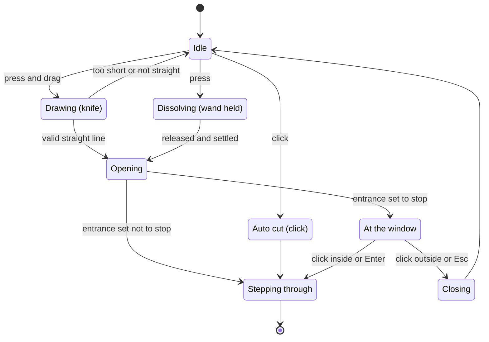

# Requirements: Space-cut transitions

Status: **Confirmed 2026-11-06**, all 13 questions in §10 settled with the recommended option (A); the design doc is confirmed too; the P0 spike is done and the language switch now has the site start the view transition itself (design doc §12, adopted), with no change to the feature itself; the P1 engine is merged; P2 (camera AR and the language switch) is merged; P3 (404, easter egg, hint) is merged; P4 (gesture mode) is done, awaiting review · Prototype: [神刀转场](https://claude.ai/artifact/PSnnoBieR9vYQ4p3VUNEQS) (private page; its source exists only in that published page)

## 1. Goal

In the few places on the portfolio where a visitor steps into a different experience, replace the plain switch with a transition that cuts the screen open onto another world. The idea comes from the subtle knife in *His Dark Materials*, which cuts windows between worlds, and from the image of breaking through space with a wand.

What it should achieve:
- Visitors remember the site.
- It fits the site's XR and computer vision theme: there is another world behind the screen.
- Everyday browsing stays fast: frequent links keep switching quickly.

## 2. Who uses it

| Who | Situation | What they care about |
| :--- | :--- | :--- |
| Recruiters and interviewers | Skim projects and experience, clicking a dozen links in one visit | Speed, no interruptions while reading |
| Visitors and peers interested in XR and graphics | Try camera AR, switch languages, click around | Fun, detail, a sense of engineering skill |
| Keyboard and screen reader users | No mouse or touch | Doing the same things without dragging or long presses |
| Visitors with "reduce motion" turned on | Large animations turned off in system settings | No large movement or scaling |
| You (the site's author) | Maintain the site | Readable code, easy tuning, nothing existing breaks |

## 3. How it works

There are three ways in. Everything below is how the prototype behaves today.

### 3.1 Knife cut

- Press and drag to draw a line.
- On release the stroke is fitted to a straight line, which must meet both conditions:
  - It is at least 20% of the screen's short side, and at least 110 px.
  - No point strays from the line by more than 12% of its length.
- If it fails, the line fades and a hint says it was too short or not straight.
- If it passes, the line snaps taut, pauses, and parts into a lens-shaped window with a thin cyan rim.

### 3.2 Wand (hold to control)

- On press, the wand tip lights up, space starts dissolving from that point, and gold ripples spread out.
- The longer the hold, the bigger the hole: it reaches full size in about 1.6 s, and full size is 36% of the short side.
- On release the hole grows a little more and stops. A quick tap opens a small window, 10% of the short side.
- The hole is an irregular, gently moving shape, with gold dust drifting off its edge. The gold is the site's existing amber `#fbbf6a` (Q10).
- The first time the pointer is over a place where the wand works, a small "hold" hint appears; once seen it does not come back, remembered in the browser (Q5).

### 3.3 Click to cut (links and buttons)

- Clicking a link or button cuts automatically from the click point and goes straight through, without stopping at a window.

### 3.4 Once a window is open

- **Stop at the window**: the world behind shifts slightly with the pointer, so it seems to sit deeper behind the screen.
  - Click inside the window, or press Enter: step through.
  - Click outside it, or press Esc: close it.
- **Step through**: the window grows until it fills the screen, arriving at the new page or view.
- **Close**:
  - A knife cut closes from both sides and leaves a scar that fades.
  - A wand hole shrinks and the dust is drawn back to the center.

Keyboard only (Q4): with focus on an entrance, Enter or Space opens a medium window and stops there; Enter again steps through and Esc closes it.

### 3.5 Hand gestures (camera)

- A "Try it with your hand" switch sits next to the home page's 3D viewport, and the browser asks for camera permission only after a visitor turns it on (Q11). Computers come first; phones wait until real devices have been tried (Q13).
- The picture is mirrored, like a mirror.
- One hand:
  - Pinching thumb and index finger together is a press; letting go is a release.
  - A ring cursor follows the midpoint of the two fingertips and shrinks to a solid dot while pinched.
- All three ways in work:
  - Pinch and draw a straight line to make a knife cut.
  - Pinch and hold to hold the wand.
  - Pinch and let go to click.
  - Once a window is open, a pinch inside it steps through and a pinch outside closes it.
- The middle of the camera picture (12% margins left, right and top, 18% at the bottom) maps to the whole screen, so the hand never has to reach the edge of the frame.
- If the hand leaves the picture for more than 0.3 s, it counts as a release.
- Hands shake in the air, so:
  - The cursor is smoothed with a One Euro filter.
  - The knife's straightness limit is loosened from 12% to 16%.
  - The movement allowed for a click is loosened from 12 px to 40 px.
- A small camera window in the top right shows the picture, the detected hand skeleton, a dashed box for the mapped area and the current state (no hand, open, pinched).

## 4. Where it is used (Q1, Q2)

Principle: links a visitor uses again and again in one visit (everyday page switches) get no cut and stay fast. Places used once or twice per visit, whose point is to try something (special entrances), get the cut.

| Place | Today | Behind the window | Proposed way in | Stop at the window |
| :--- | :--- | :--- | :--- | :--- |
| "Try camera AR" on the home page | A button opens a full-screen overlay (`?ar=camera`, `?ar=board`) | On phones, the camera view; on desktops, the on-screen board and QR code | Click to cut, from the button (Q3) | Yes; on phones it first shows "Opening the camera" and fades the view in when it arrives (Q9) |
| Language switch in the header (EN / 中文) | Goes to the same page in the other language | The same page in the other language | Click to cut, from the button | No |
| 404 page | A card and a "Back to home" button | The home page | Knife or wand back to the home page; the button stays | No |
| Easter egg (new), at first only inside the home page's 3D viewport (Q6) | None | An engineering view of the 3D scene: wireframes, corner points, axes | Knife or wand | Yes |
| Everyday header links | Plain switch | | No cut (Q7) | |
| Project card to detail page | Plain switch | | No cut; the card grows into the detail page's header image (a shared-element transition, Q7) | |

On phones, drawing and holding work only in areas that do not scroll: the home page's 3D viewport, full-screen overlays and the 404 page (Q8).

## 5. Features

A feature is marked "done" only after it has been tried on real iPhone Safari and Android Chrome devices and in a desktop browser, with keyboard use and reduce motion checked.

| # | Feature | Status |
| :--- | :--- | :--- |
| F1 | Knife cut: straight-line check, snapping taut, lens window, cyan rim | Usable on the site in the home page's 3D viewport (the easter egg) and on the 404 page (tried with a mouse in desktop Chromium; not on phones, Safari or Firefox) |
| F2 | Wand: hold to set the size, gold dust, ripples, moving edge | Usable on the site in the home page's 3D viewport (the easter egg) and on the 404 page, but holding was not tried in those two places (the browser tool here cannot hold a press), only on P1's test page; not tried on phones |
| F3 | Click to cut | Playable in the prototype (tried in a desktop browser, not on a phone); on the site the language switch and the camera AR button use it (tried in desktop Chromium; not on phones, Safari or Firefox) |
| F4 | Stopping at the window, parallax, stepping through, closing (scar, dust drawn back) | Usable on the site: camera AR and the easter egg stop at the window; clicking inside steps through, clicking outside or Esc closes it with a scar (tried in desktop Chromium). In the easter egg the camera following the pointer stands in for parallax; the wand's dust being drawn back on close was only tried on P1's test page |
| F5 | Crossfade instead when reduce motion is on | A switch in the prototype that follows the system setting by default; on the site the language switch crossfades instead (tried in desktop Chromium with the setting simulated by script); camera AR's crossfade has unit tests only |
| F6 | Keyboard use: Enter or Space opens a window and stops, Enter steps through, Esc closes (Q4) | Usable on the site: on the camera AR button and the home page's viewport (now reachable with Tab), Enter opens a window and stops, Enter again steps through, Esc closes; in the engineering view Esc returns straight away; Enter on the 404 page's buttons cuts straight through (tried in desktop Chromium for camera AR and the easter egg; Enter on the 404 page not tried on its own) |
| F7 | A "hold" hint for the wand the first time, not shown again once seen (Q5) | Usable on the site: it appears next to the pointer the first time the mouse is over the viewport or the 404 page's blank areas, and is remembered in local storage (tried on the home page in desktop Chromium); the touch behavior not tried |
| F8 | Camera AR entrance | Usable on the site, tried in desktop Chromium: it cuts from the button and stops; clicking inside or Enter steps through, clicking outside or Esc closes. Not tried on phones (including "Opening the camera" in the middle of the window) |
| F9 | Language switch | Usable on the site, tried in desktop Chromium (the dev server and the static build, also from the phone-width menu): the whole page is cut open from the button. Not tried in Safari, Firefox or on real phones |
| F10 | 404 page | Usable on the site: a stroke or the wand in a blank area, or the "Back to home" buttons, cut open and go to the home page (tried the knife and the button in desktop Chromium on the static build; not on phones) |
| F11 | Easter egg: cut open the home page's 3D viewport to see an engineering view of the 3D scene (Q6) | Usable on the site: the window shows the engineering view, stepping through swaps the two views, and cutting again or Esc swaps back (tried in desktop Chromium; phone performance not measured) |
| F12 | New copy (hints and the like) in Chinese and English, in `src/data/profile.ts` | Hints at the window for camera AR and the easter egg, the "hold" hint, the too-short and not-straight hints, the "Engineering view" label and the viewport's accessible description, in both languages; the 404 page shows its hints in both languages side by side |
| F13 | Hand gestures (camera): a switch on the home page, computers only at first (Q11, Q13); pinch to press, all three ways in, a cursor that follows the hand, a camera window | On the site; you tried it with a webcam on a computer (2026-11-06) and it works overall. The knife and the wand were hard to tell apart, so for hands the wand now waits 450 ms, with a gold ring on the cursor (design doc §13, P4); that change has not been tried with the camera yet. Phones, Safari and Firefox not tried |
| F14 | A header image on the project detail page (the card's image, above the title), which the card's cover grows into (a shared-element transition, Q7, D6) | Not started; not in the prototype |

## 6. Non-functional requirements

### Speed
- A click-triggered transition (F3) takes no more than 1 s in total. The prototype takes about 1.04 s, so it needs trimming.
- The step-through expansion takes no more than 0.8 s. The parts the visitor controls (drawing, holding) have no limit.
- Animations hold 60 fps on a mid-range phone:
  - The number of dust particles is capped (1,500 in the prototype).
  - The dust canvas renders at no more than 2× device pixel ratio.
- The effect code downloads only when it is needed, stays out of the first load, and does not slow the home page.
- Gesture mode's model and runtime, about 11.5 MB the first time, download only when a visitor turns gesture mode on.
- The header stays still during a transition, and the page is clickable as soon as it ends.

### Compatibility
- Where the browser lacks support (view transitions, `clip-path` and so on), pages switch directly: everything still works and nothing errors.
- The site stays a static export (`output: "export"`) with no server.

### Accessibility
- With reduce motion on, transitions become a short crossfade with no large movement or scaling. The existing `MotionProvider` already makes Motion animations follow this setting, and the transitions match it.
- Anything done by dragging or long-pressing can also be done from the keyboard (Q4).
- The effects are hidden from screen readers; focus and announcements after a switch stay as they are today.
- Gestures are an extra way in only; mouse, touch and keyboard keep working.

### Privacy
- No new data is collected.
- At most, a "hint seen" flag is kept in the browser's local storage (Q5).
- The camera is used only inside the existing camera AR and in gesture mode when a visitor turns it on. Gesture mode processes the picture only in the visitor's own browser and uploads nothing.
- The gesture model and runtime live in the site's own files (Q12), so visitors do not connect to jsDelivr or Google for them.
- The privacy page has to describe the camera use. (Added in P4; P4 also found that MediaPipe posts usage logs to Google, which are now blocked before it loads, see design doc §13.)

### Devices
- On phones, dragging and long presses work only in areas that do not scroll: the home page's 3D viewport, full-screen overlays and the 404 page (Q8), so normal scrolling and tapping are unaffected.
- A long press on a phone does not open the system menu. The prototype handles this, but it has not been checked on a real device.
- Without a camera, without permission, or when the model fails to load, gesture mode falls back to mouse and touch and says why (the prototype already does this).

### Copyright
- The site never shows the names, images, music or sounds of *His Dark Materials*, *Harry Potter* or similar works. Only the interaction ideas are borrowed.

### Two languages
- All new copy exists in Chinese and English.

### Maintainability
- Durations, colors and thresholds live in one set of constants, and so do the gesture thresholds (pinch and release ratios, the mapped area, how long a missing hand counts as a release).
- The geometry (line fitting, window shapes, how far to scale to cover the screen) is written as pure functions with Vitest tests.
- The site's own files gain about 11.5 MB of gesture model and runtime (Q12). Whether they are committed to the repo or downloaded at build time is decided in the design.

## 7. Known facts

From the existing code and docs.

| Fact | Consequence |
| :--- | :--- |
| Next 16.4.2 and React 19.3 include `<ViewTransition>`, and `Link` has `transitionTypes` (see `node_modules/next/dist/docs/01-app/02-guides/view-transitions.md`) | Cuts between pages can use the browser's view transitions, with no new dependency |
| During a view transition, the old and new pages are still snapshots | Between pages, the picture inside the cut does not move |
| The Next docs say these transitions need Chromium 125+ or recent Safari and Firefox, and that without support pages switch normally, just without animation | This meets "switch directly when unsupported" |
| Camera AR is a full-screen overlay on the home page, with its state in `?ar=`, not a separate page (`src/components/HeroViewport.tsx`) | Camera AR opens in place, as in the prototype, so the window can show the live view |
| The language switch replaces the leading `/zh` with `/en`, and `[lang]` is the root layout (`src/app/[lang]/layout.tsx`). Checked on 2026-11-06 against the 11-04 static build served locally: after switching, a JS variable on the page survives and `<html lang>` becomes `en`, so it is a client-side navigation | Same-document view transitions work; no cross-document version is needed |
| The 404 page is `src/app/global-not-found.tsx` and uses no layout. Checked the same day: "Back to home" from the 404 page is a full page load | The 404 cut cannot use view transitions and has to open in place |
| Hand landmarks come from Google's MediaPipe Tasks Vision 1.1.1 (Apache-2.0 license): the runtime is about 3.6 MB compressed and the hand model 7.8 MB | Gesture mode adds about 11.5 MB of downloads, and it uses a ready-made model rather than code written from scratch like camera AR |
| The camera needs a secure context (HTTPS or localhost); a LAN `http://` address does not work (README) | Trying gestures on a phone has to wait until it is deployed over HTTPS |
| The privacy page (`privacy` in `src/data/profile.ts`) does not mention the camera today, not even for the existing camera AR | It needs a camera line when gesture mode is added, and camera AR can be covered at the same time |

## 8. Out of scope

- Sound.
- The glass-shatter effect (rejected) and the fixed-duration wand (not chosen).
- The full cut effect on everyday navigation.
- A control panel for visitors (speed, mode, choice of world): these are prototype-only tools.
- WebGL effects such as shattering or refracting the whole page.
- Changes to the content or layout of existing pages. Exception: a header image on the project detail page (D6).
- Transitions for external links and for WebXR sessions themselves.
- Two-handed gestures.
- Writing our own hand tracker in this phase (the bright-spot, color or motion approaches).

## 9. Decided

| # | Decision | Date |
| :--- | :--- | :--- |
| D1 | Compare the feel in a prototype kept out of the repo, then write this requirements doc, and touch the project code only after it is confirmed | 2026-11-05 |
| D2 | The wand does not use a glass-shatter effect ("like punching through a mirror"); space dissolves into gold dust instead | 2026-11-06 |
| D3 | The wand is hold to control: space starts dissolving on press, the hole grows as long as it is held and stops on release; no fixed duration | 2026-11-06 |
| D4 | Add hand gestures (camera): pinching thumb and index finger is a press. Tried on a PC webcam and found smooth | 2026-11-06 |
| D5 | Q1–Q13 in §10 all settled with the recommended option (A) | 2026-11-06 |
| D6 | For Q7's shared-element transition, the project detail page gets a header image: the card's image, above the title (design doc OQ-2) | 2026-11-06 |

## 10. Resolved details

All settled with A on 2026-11-06 (D5).

| # | Question | Adopted (A) | Not adopted |
| :--- | :--- | :--- | :--- |
| Q1 | Where to use the cut | As in §4, only at special entrances, nothing on everyday navigation | A light version on everyday navigation too |
| Q2 | Which way in for each entrance, and whether it stops at the window | The table in §4 | Adjust row by row |
| Q3 | How the "Try camera AR" button opens | A click cuts it open automatically (buttons are clicked); holding the wand is kept for places where visitors can press anywhere | Hold the button to dissolve it open with the wand |
| Q4 | How keyboard-only visitors use it | Enter or Space on the entrance opens a medium window and stops there; Enter steps through and Esc closes it | Go straight through without stopping |
| Q5 | How visitors learn the wand can be held | A small "hold" hint the first time the pointer is over it, not shown again after it has been seen (remembered in the browser) | Show it every time; no hint |
| Q6 | How the easter egg is triggered | Cutting only inside the home page's 3D viewport at first, a small scope that can grow later | A small knife icon in the footer that turns on cutting on every page; no easter egg |
| Q7 | What everyday navigation does | The project card grows into the detail page's header image (a shared-element transition), nothing on header links | Nothing; a thin line flashing across (under 0.3 s) |
| Q8 | Where phones allow drawing and holding | Only in areas that do not scroll: the home page's 3D viewport, full-screen overlays and the 404 page | Anywhere, after turning on a knife mode |
| Q9 | What the camera AR window shows first (phones wait for camera permission, so the view may still be black when the window opens) | Open the window with "Opening the camera" inside and fade the view in when it arrives | Wait for the view before opening the window |
| Q10 | The wand's gold | The site's existing amber `#fbbf6a` (the game engines category color), no new color | The prototype's new gold `#f7c96b` |
| Q11 | Where gesture mode lives | A "Try it with your hand" switch next to the home page's 3D viewport, asking for the camera only when a visitor turns it on | Only inside camera AR; both |
| Q12 | Where the model and runtime load from | The site's own static files, so visitors never connect to jsDelivr or Google; the deployment grows by about 11.5 MB | jsDelivr and Google, as in the prototype |
| Q13 | Whether phones get gestures | Computers first, and decide on phones after trying real devices | Phones from the start |

## 11. Next steps

Confirmed on 2026-11-06. Next:

1. The design doc `docs/design_space_cut.md` (and its Chinese version) was written and confirmed on 2026-11-06.
2. Build it in the design doc's phases, starting with the P0 spike, stopping for review at the end of each phase and updating the status in §5.
