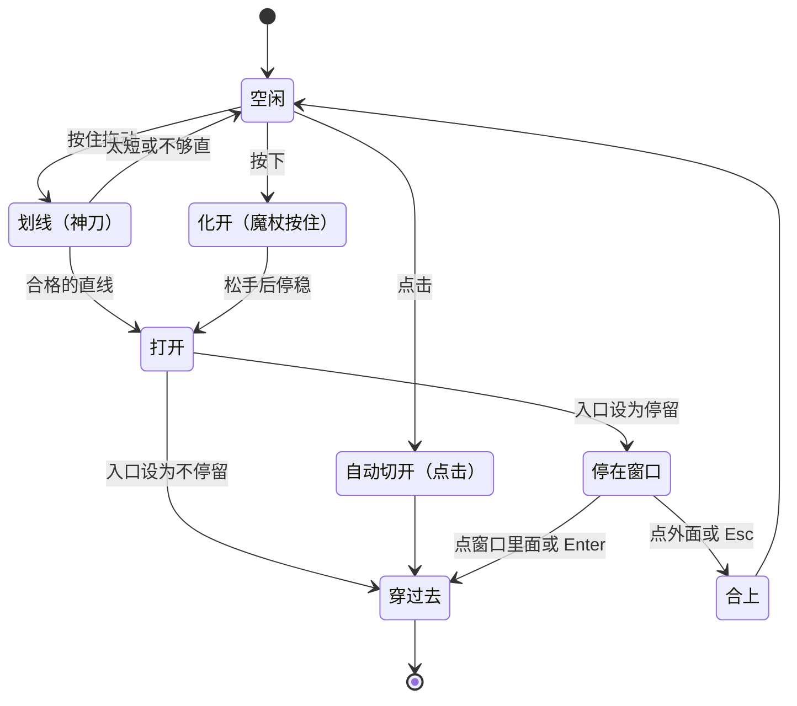

# 需求：空间切口转场

状态：**已确认（2026-11-06）**，§10 的 13 个问题全部采用建议（A）；设计文档也已确认；P0 验证已完成，切换语言换成由网站自己发起视图过渡（设计文档 §12，已采用），功能本身不变；P1 引擎已合入；P2（摄像头 AR 和语言切换）已合入；P3（404、彩蛋、提示）已合入；P4（手势模式）已完成，待评审 · 小样：[神刀转场](https://claude.ai/artifact/PSnnoBieR9vYQ4p3VUNEQS)（私有页面；源代码只保存在这个发布的页面里）

## 1. 目标

在作品集里少数几个"进入另一种体验"的地方，用"切开屏幕、看到另一个世界"的转场代替直接切换。灵感来自《黑暗物质》里能切开世界之间屏障的神刀，以及用魔杖点破空间的想象。

要达到的效果：
- 访客记得住这个网站。
- 和网站 XR、计算机视觉的主题一致：屏幕背后还有一个世界。
- 不拖慢日常浏览：常用的跳转仍然要快。

## 2. 谁会用到

| 谁 | 场景 | 在意什么 |
| :--- | :--- | :--- |
| 招聘方、面试官 | 快速看项目和经历，一次访问会点十几次链接 | 快，不打断阅读 |
| 对 XR、图形感兴趣的访客和同行 | 会去试摄像头 AR、切换语言、到处点 | 有趣、有细节、能看出工程水平 |
| 只用键盘或读屏的访客 | 不用鼠标和触屏 | 不靠拖动和长按也能做同样的事 |
| 开启"减少动态效果"的访客 | 系统设置里关掉了大动画 | 没有大范围的移动和缩放 |
| 你（网站作者） | 维护网站 | 代码好懂，参数好调，不影响现有功能 |

## 3. 怎么操作

一共三种方式，以下都是小样里现在的行为。

### 3.1 划一刀（神刀）

- 按住拖动，画一条线。
- 松手时把这一笔拟合成直线，要同时满足两个条件：
  - 线长至少是屏幕短边的 20%，并且不少于 110 px。
  - 偏离直线最远的点不超过线长的 12%。
- 不满足时，线淡掉，并提示"太短了"或"不够直"。
- 满足时，线先绷直，停一下，两边分开成一扇透镜形的窗。窗的边缘是一道青色细线。

### 3.2 魔杖（按住控制）

- 一按下，杖尖亮起，空间从这一点开始化开，金色涟漪往外荡。
- 按得越久，洞越大：约 1.6 秒长到最大，最大是屏幕短边的 36%。
- 松手后，洞口再长一点点就停住。轻点一下也会开一个小窗，大小是短边的 10%。
- 洞口是一圈会轻轻起伏的不规则形状，金色尘埃从边缘飘出来。金色用网站已有的琥珀色 `#fbbf6a`（Q10）。
- 第一次把指针放到可以用魔杖的地方时，显示一个"按住"的小提示；看过一次就不再显示，记在浏览器本地（Q5）。

### 3.3 点击自动切（链接和按钮）

- 点一个链接或按钮，从点击的位置自动切一刀，直接穿过去，不在窗口停留。

### 3.4 窗口打开以后

- **停在窗口**：窗后的世界随鼠标轻微移动，看起来在屏幕后面更深的地方。
  - 点窗口里面，或按 Enter：穿过去。
  - 点窗口外面，或按 Esc：合上。
- **穿过去**：窗口扩大到铺满屏幕，到达新页面或新画面。
- **合上**：
  - 神刀的切口两边合拢，留下一道慢慢消失的切痕。
  - 魔杖的洞口收拢，尘埃被吸回中心。

只用键盘时（Q4）：焦点在入口上按 Enter 或空格，开一个中等大小的窗并停住；再按 Enter 穿过去，按 Esc 合上。

### 3.5 手势操作（摄像头）

- 首页 3D 取景框旁边有一个"用手势试试"的开关，访客主动打开后浏览器才请求摄像头权限（Q11）。先只支持电脑，手机等真机试过再决定（Q13）。
- 画面左右镜像，像照镜子。
- 用一只手：
  - 拇指和食指捏住等于按下，松开等于抬起。
  - 屏幕上有一个圆圈光标，跟着两个指尖的中点走，捏住时缩成实心点。
- 三种方式都能用：
  - 捏着划一条直线，就是划一刀。
  - 捏住不放，就是魔杖按住。
  - 捏一下再松开，就是点击。
  - 窗口打开后，在窗口里面捏一下就穿过去，在外面捏一下就合上。
- 摄像头画面中间的一块（左右各留 12%，上面留 12%，下面留 18%）对应整个屏幕，手不用伸到画面边上。
- 手离开画面超过 0.3 秒，就当作松开。
- 手在空中会抖，所以：
  - 光标用 One Euro 滤波平滑。
  - 划一刀的直线判定从 12% 放宽到 16%。
  - "点一下"允许的移动范围从 12 px 放宽到 40 px。
- 右上角的摄像头小窗显示画面、识别出的手部骨架、映射区域的虚线框和当前状态（没看到手、张开、捏住）。

## 4. 用在哪里（Q1、Q2）

原则：一次访问会反复用到的跳转（普通页面切换）不加切口，保持快；一次访问只用一两次、本来就是让人"体验一下"的地方（特殊入口）才用切口。

| 位置 | 现在 | 窗后是什么 | 建议的方式 | 窗口停不停 |
| :--- | :--- | :--- | :--- | :--- |
| 首页的"试试摄像头 AR" | 按钮打开全屏叠层（`?ar=camera`、`?ar=board`） | 手机上是摄像头画面；桌面上是屏幕标定板和二维码 | 点击自动切：点按钮，从按钮的位置切开（Q3） | 停；手机上先显示"正在打开摄像头"，画面出来后淡入（Q9） |
| 导航栏的中英切换（EN / 中文） | 跳到另一种语言的同一页 | 同一页的另一种语言 | 点击自动切，从按钮的位置切开 | 不停 |
| 404 页 | 一张卡片和"回到首页"按钮 | 首页 | 划一刀或魔杖回首页，按钮保留 | 不停 |
| 彩蛋（新增），先只在首页 3D 取景框里（Q6） | 没有 | 3D 场景的工程视角：线框、角点、坐标轴 | 划一刀或魔杖 | 停 |
| 导航栏的日常跳转 | 直接切换 | | 不加切口（Q7） | |
| 项目卡片到详情页 | 直接切换 | | 不加切口；卡片放大成详情页头图（共享元素过渡，Q7） | |

手机上，划线和按住只在不滚动的区域生效：首页 3D 取景框、全屏叠层和 404 页（Q8）。

## 5. 功能清单

只有在 iPhone Safari、Android Chrome 真机和桌面浏览器上都试过，并且检查过键盘操作和"减少动态效果"，才标"完成"。

| # | 功能 | 状态 |
| :--- | :--- | :--- |
| F1 | 划一刀：直线判定、线绷直、透镜形窗口、青色边缘 | 网站上首页 3D 取景框的彩蛋和 404 页都能用（桌面 Chromium 用鼠标试过；手机、Safari、Firefox 没试） |
| F2 | 魔杖：按住控制大小、金色尘埃、涟漪、会起伏的洞口 | 网站上首页 3D 取景框的彩蛋和 404 页都能用；但在这两处没亲手试过按住（这里的浏览器工具做不了按住不放），只在 P1 的临时页面上试过；手机没试 |
| F3 | 点击自动切 | 小样里可以玩（桌面浏览器试过，手机没试）；网站上语言切换和摄像头 AR 的按钮已经用上（桌面 Chromium 试过；手机、Safari、Firefox 没试） |
| F4 | 停在窗口、视差、穿过去、合上（切痕、尘埃收回） | 网站上可以用：摄像头 AR 和彩蛋停在窗口，点窗里穿过去，点窗外或 Esc 合上并留下切痕（桌面 Chromium 试过）。彩蛋里用镜头跟随指针代替视差；魔杖合上时尘埃收回只在 P1 的临时页面上试过 |
| F5 | 减少动态效果时改成淡入淡出 | 小样里有开关，默认跟随系统设置；网站上语言切换会改成淡入淡出（桌面 Chromium 里用脚本模拟系统设置试过）；摄像头 AR 的淡入淡出只有单元测试 |
| F6 | 键盘操作：Enter 或空格开窗并停住，Enter 穿过去，Esc 合上（Q4） | 网站上可以用：摄像头 AR 的按钮和首页取景框（能用 Tab 聚焦）上按 Enter 开窗并停住，再按 Enter 穿过去，Esc 合上；在工程视角里 Esc 直接回来；404 页的按钮上按 Enter 直接切过去（桌面 Chromium 试过摄像头 AR 和彩蛋，404 的回车没单独试） |
| F7 | 第一次用魔杖时提示"按住"，看过就不再显示（Q5） | 网站上可以用：鼠标第一次移到取景框或 404 页的空白处时出现在指针旁边，记在本地存储里（桌面 Chromium 在首页试过）；触屏上的出现方式没试 |
| F8 | 接入摄像头 AR 入口 | 网站上可以用，桌面 Chromium 试过：从按钮切开并停住，点窗里或按 Enter 穿过去，点窗外或按 Esc 合上。手机上没试（包括窗口中间的"正在打开摄像头"） |
| F9 | 接入中英切换 | 网站上可以用，桌面 Chromium 试过（开发服务器和静态构建，也试过手机宽度下的菜单）：从按钮切开整页。Safari、Firefox 和真机没试 |
| F10 | 接入 404 页 | 网站上可以用：空白处划一刀或按住魔杖、或者点"回到首页"按钮，切开后跳到首页（桌面 Chromium 在静态构建上试过刀和按钮；手机没试） |
| F11 | 彩蛋：在首页 3D 取景框里切开，看到 3D 场景的工程视角（Q6） | 网站上可以用：窗里是工程视角，穿过去两种画面对调，再切一次或按 Esc 换回来（桌面 Chromium 试过；手机上的性能没测） |
| F12 | 新文案（提示语等）的中英文，写进 `src/data/profile.ts` | 摄像头 AR 和彩蛋停在窗口时的提示、"按住"提示、划得太短或不够直的提示、"工程视角"标签和取景框的无障碍说明，中英文都有；404 页的提示中英并列 |
| F13 | 手势操作（摄像头）：首页的开关，先只支持电脑（Q11、Q13）；捏住等于按下，三种方式都能用，跟手的光标，摄像头小窗 | 网站上有了，但还没用真的摄像头和手试过：开关、拿不到摄像头权限时的提示和退路在桌面 Chromium 里试过（Claude 内置浏览器不给页面用摄像头）；从本站加载运行文件和模型并识别一次也试过；捏住、划线、按住、点击走的逐帧逻辑有单元测试。要你在自己的电脑浏览器里试 |
| F14 | 项目详情页加一张头图（用卡片的同一张图，放在标题上面），卡片封面放大成它（共享元素过渡，Q7、D6） | 未开始；小样里没有 |

## 6. 非功能需求

### 速度
- 点击触发的转场（F3）总时长不超过 1 秒。小样现在约 1.04 秒，还要再压一点。
- "穿过去"的扩张不超过 0.8 秒。访客自己控制的部分（拖线、按住）不限时。
- 动画期间，在中档手机上保持 60 fps：
  - 尘埃粒子数量有上限（小样是 1500 个）。
  - 画尘埃的 canvas 最多按 2 倍像素比渲染。
- 效果代码用到时才下载，不进首屏，不影响首页的加载速度。
- 手势模式的模型和运行库首次约 11.5 MB，只在访客主动打开手势模式时才下载。
- 转场期间导航栏不动；转场一结束，页面马上能点。

### 兼容
- 浏览器不支持（视图过渡、`clip-path` 等）时直接切换：功能照常可用，不报错。
- 网站仍然是静态导出（`output: "export"`），不需要服务器。

### 无障碍
- 系统开启"减少动态效果"时，改成短的淡入淡出，没有大范围的移动和缩放。现有的 `MotionProvider` 已经让 Motion 动画跟随这个设置，转场的处理与它一致。
- 所有靠拖动或长按完成的事，键盘也要能完成（Q4）。
- 特效本身对读屏隐藏；切换后的焦点和朗读与现在相同。
- 手势只是额外的操作方式，鼠标、触屏和键盘照常可用。

### 隐私
- 不新增任何数据收集。
- 最多在浏览器本地记一个"提示看过了"的标记（Q5）。
- 摄像头只在现有的摄像头 AR 和访客主动打开的手势模式里使用。手势模式的画面只在访客自己的浏览器里处理，不上传。
- 手势模型和运行库放在网站自己的文件里（Q12），访客不会因此连接 jsDelivr 或 Google。
- 隐私说明页要补上摄像头的用法。（P4 已加上；另外 P4 发现 MediaPipe 会往 Google 发使用日志，已在加载前拦下，见设计文档 §13。）

### 设备
- 手机上的拖动和长按只在不滚动的区域生效：首页 3D 取景框、全屏叠层和 404 页（Q8），不妨碍正常滚动和点击。
- 手机上长按不弹出系统菜单：小样已经处理，还没有在真机上验证。
- 没有摄像头、不给权限或者模型加载失败时，手势模式退回鼠标和触屏，并说明原因（小样已经这样处理）。

### 版权
- 网站上不出现《黑暗物质》《哈利·波特》等作品的名称、图片、音乐或音效。借用的只是交互概念。

### 双语
- 所有新文案都有中文和英文。

### 可维护
- 时长、颜色、阈值集中成常量，手势的阈值（捏住和松开的比例、映射区域、手消失多久算松开）也一样。
- 几何计算（直线拟合、窗口形状、铺满屏幕要放大的倍数）写成纯函数，用 Vitest 测试。
- 网站自己的文件里会多出约 11.5 MB 的手势模型和运行库（Q12）。是提交进仓库，还是构建时下载，在设计阶段决定。

## 7. 已知事实

来自现有代码和文档。

| 事实 | 影响 |
| :--- | :--- |
| Next 16.4.2 和 React 19.3 自带 `<ViewTransition>`，`Link` 有 `transitionTypes`（见 `node_modules/next/dist/docs/01-app/02-guides/view-transitions.md`） | 换页面时的切口可以用浏览器的视图过渡来做，不需要新依赖 |
| 视图过渡期间，新旧页面都是静止的快照 | 换页面时，切口里的画面不会动 |
| Next 文档写明：这些过渡需要 Chromium 125+ 或较新的 Safari、Firefox；不支持时正常切换，只是没有动画 | 满足"不支持就直接切换" |
| 摄像头 AR 是首页上的全屏叠层，开没开记在 `?ar=` 里，不是新页面（`src/components/HeroViewport.tsx`） | 摄像头 AR 的切口和小样一样原地切开，窗里可以显示实时画面 |
| 中英切换把路径开头的 `/zh` 换成 `/en`，`[lang]` 是根布局（`src/app/[lang]/layout.tsx`）。2026-11-06 在本地用 11-04 的静态构建实测：切换后页面里的 JS 变量还在，`<html lang>` 变成 `en`，是页面内跳转 | 可以用同页面的视图过渡，不需要跨文档的版本 |
| 404 页是 `src/app/global-not-found.tsx`，不经过任何布局。同一天实测：从 404 点"回到首页"是整页加载 | 404 的切口不能用视图过渡，要原地切开 |
| 手部关键点来自 Google 的 MediaPipe Tasks Vision 1.1.1（Apache-2.0 许可）：运行库压缩后约 3.6 MB，手部模型 7.8 MB | 手势模式要多下载约 11.5 MB；用的是现成模型，不像摄像头 AR 那样从零写 |
| 摄像头需要安全环境（HTTPS 或 localhost），局域网里的 `http://` 地址不行（README） | 手机上试手势，要等部署到 HTTPS 以后 |
| 隐私说明（`src/data/profile.ts` 里的 `privacy`）目前没有提到摄像头，现有的摄像头 AR 也没写 | 加手势模式时要补上，摄像头 AR 的说明可以一起补 |

## 8. 不做的事

- 声音。
- 碎玻璃效果（已否决），以及固定时长的魔杖（没有选）。
- 在日常导航上用完整的切口效果。
- 给访客的调节面板（速度、方式、选世界）：这些只是小样里的调试工具。
- 用 WebGL 给整页做碎片、折射一类的效果。
- 改动现有页面的内容和布局。例外：项目详情页加一张头图（D6）。
- 外部链接和 WebXR 会话本身的转场。
- 双手手势。
- 这一阶段不自己写手势追踪器（追踪亮点、颜色或运动的方案）。

## 9. 已定的事

| # | 决定 | 日期 |
| :--- | :--- | :--- |
| D1 | 先做不放进仓库的小样比较手感，再写需求文档，确认后才动项目代码 | 2026-11-05 |
| D2 | 魔杖不用碎玻璃效果（"像一拳打碎了一面镜子"），改成空间化成金色尘埃 | 2026-11-06 |
| D3 | 魔杖用"按住控制"：一按下就开始化开，按多久开多大，松手就停；不用固定时长 | 2026-11-06 |
| D4 | 加入手势操作（摄像头）：拇指和食指捏住等于按下。电脑摄像头上试过，顺手 | 2026-11-06 |
| D5 | §10 的 Q1–Q13 全部采用建议（选项 A） | 2026-11-06 |
| D6 | 为了 Q7 的共享元素过渡，项目详情页加一张头图：用卡片的同一张图，放在标题上面（设计文档 OQ-2） | 2026-11-06 |

## 10. 已定细节

2026-11-06 全部采用 A（D5）。

| # | 问题 | 采用（A） | 未采用 |
| :--- | :--- | :--- | :--- |
| Q1 | 用切口的地方 | 按 §4，只用在特殊入口，日常导航不加 | 日常导航也加轻量版本 |
| Q2 | 每个入口用哪种方式、窗口停不停 | 按 §4 的表 | 逐项调整 |
| Q3 | "试试摄像头 AR"按钮怎么打开 | 点一下，自动切开（按钮的习惯是点）；魔杖的按住留给可以随便点画面的地方 | 按住按钮，用魔杖化开 |
| Q4 | 只用键盘时怎么用 | 在入口上按 Enter 或空格，开一个中等大小的窗并停住，再按 Enter 穿过去，按 Esc 合上 | 直接穿过去，不停 |
| Q5 | 怎么让访客知道魔杖可以按住 | 第一次把指针放上去时显示"按住"的小提示，看过一次后不再显示（在浏览器本地记住） | 每次都显示；不提示 |
| Q6 | 彩蛋怎么触发 | 先只在首页 3D 取景框里可以划，范围小，以后再扩展 | 页脚放一个小刀图标，在任何页面都能划；不做彩蛋 |
| Q7 | 日常跳转怎么处理 | 项目卡片放大成详情页头图（共享元素过渡），导航栏不加 | 什么都不加；一道细线闪过（0.3 秒内） |
| Q8 | 手机上哪里可以划和按住 | 只在不滚动的区域：首页 3D 取景框、全屏叠层、404 页 | 任何地方，先打开"刀"模式 |
| Q9 | 摄像头 AR 的窗口里先显示什么（手机要等摄像头权限，窗口打开时画面可能还是黑的） | 先开窗，里面显示"正在打开摄像头"，画面出来后淡入 | 等画面出来再开窗 |
| Q10 | 魔杖的金色 | 网站已有的琥珀色 `#fbbf6a`（游戏引擎分类色），不加新颜色 | 小样里新的金色 `#f7c96b` |
| Q11 | 手势模式放在哪里 | 首页 3D 取景框旁边的"用手势试试"开关，访客主动打开才请求摄像头 | 只放在摄像头 AR 里；两处都放 |
| Q12 | 模型和运行库从哪里加载 | 网站自己的静态文件，访客不需要连接 jsDelivr 和 Google；部署要多放约 11.5 MB | 和小样一样，从 jsDelivr 和 Google 加载 |
| Q13 | 手机支不支持手势 | 先只支持电脑，手机等真机试过再决定 | 一开始就支持手机 |

## 11. 下一步

2026-11-06 已确认，接下来：

1. 设计文档 `docs/design_space_cut.md`（和中文版）已于 2026-11-06 写好并确认。
2. 按设计文档的分期实现，从 P0 验证开始，每期结束时停下来评审，并更新本文档 §5 的状态。
